<!-- START doctoc generated TOC please keep comment here to allow auto update -->
<!-- DON'T EDIT THIS SECTION, INSTEAD RE-RUN doctoc TO UPDATE -->
**Table of Contents**  *generated with [DocToc](https://github.com/thlorenz/doctoc)*

- [Neural Network Training Demystified: From Gradient Descent to a Language Model](#neural-network-training-demystified-from-gradient-descent-to-a-language-model)
  - [1. The big picture](#1-the-big-picture)
  - [2. Gradient descent](#2-gradient-descent)
    - [The hill analogy](#the-hill-analogy)
    - [What the gradient is](#what-the-gradient-is)
    - [The update rule](#the-update-rule)
    - [The learning rate](#the-learning-rate)
    - [Back to the original example](#back-to-the-original-example)
  - [3. Backpropagation](#3-backpropagation)
    - [The key idea: the chain rule](#the-key-idea-the-chain-rule)
    - [Two passes](#two-passes)
    - [Credit assignment](#credit-assignment)
    - [A worked example: a small two-layer network](#a-worked-example-a-small-two-layer-network)
  - [4. Activation functions](#4-activation-functions)
  - [5. From one prediction to a real training sample](#5-from-one-prediction-to-a-real-training-sample)
  - [6. Putting it together](#6-putting-it-together)
    - [The training loop](#the-training-loop)
    - [Common variants](#common-variants)
    - [Common pitfalls](#common-pitfalls)
    - [Summary](#summary)
  - [Appendix A: Rotary position embeddings in detail](#appendix-a-rotary-position-embeddings-in-detail)
  - [References](#references)

<!-- END doctoc generated TOC please keep comment here to allow auto update -->

# Neural Network Training Demystified: From Gradient Descent to a Language Model

**Before you start.** This guide builds everything up step by step, with a worked example for each idea.

- **What you need coming in:** comfort with basic algebra (plugging numbers into a formula, rearranging an equation), the idea of a function (an input goes in, an output comes out), and simple notation such as subscripts (w₁, w₂).
- **Explained along the way:** derivatives, the chain rule and partial derivatives (section 2); vectors, dot products, cosines, cosine similarity and matrix multiplication (section 5); eˣ, ln, probabilities and softmax (section 5).
- **Helpful, but not required:** some calculus, linear algebra or basic trigonometry, from high school or an introductory university course, will make sections 2 and 5 feel familiar. If you don't have it, everything is explained when it first appears. No programming is needed.

## 1. The big picture

A machine learning model, such as a neural network, is a function with lots of adjustable knobs called **parameters** (or **weights**). Training means turning those knobs until the model's predictions match the real answers as closely as possible.

To illustrate basic concepts and keep things concrete, we'll use the smallest possible model: one input x, one weight w, and this prediction function:

$$
\hat{y} = f(x; w) = w x
$$

Our training data is a single example: input x = 2, with target value y = 8. The weight that fits perfectly is obviously w = 4, but the model doesn't know that. Training starts from a guess, w = 1, which predicts ŷ = 1 × 2 = 2, well short of 8. The error (the residual) is y − ŷ = 8 − 2 = 6.

To know how well it is doing, we measure a single number called the **loss** (or cost). The loss is large when predictions are bad and small when they are good. Training is therefore a search for the set of weights that makes the loss as small as possible.

**Loss functions.** There are many ways to measure "how wrong", and each one is a different **loss function**. We'll write the loss as **L**. It depends on the model's weights w, because changing the weights changes the predictions, so we often write it as L(w).

One of the most common loss functions, especially when the model predicts numbers (regression), is the **Residual Sum of Squares (RSS)**. For each training example i, the *residual* is the gap between the target value yᵢ and the model's prediction ŷᵢ (read "y-hat"). We square each residual, so misses in either direction count and big misses count much more than small ones, and then add them up over all n examples:

$$
L(w) = \mathrm{RSS} = \sum_{i=1}^{n} \left(y_i - \hat{y}_i\right)^2 = (y_1 - \hat{y}_1)^2 + (y_2 - \hat{y}_2)^2 + \dots + (y_n - \hat{y}_n)^2
$$

Here ŷᵢ = f(xᵢ; w) is the prediction the model with weights w makes for input xᵢ. For example, set our running example aside for a moment and imagine some other model. We don't need to know what's inside it: it could be a single multiplication or a huge neural network. All RSS needs is what the model predicted for each example and what the target value was. Say we have n = 3 examples:

| Example i | Target yᵢ | Prediction ŷᵢ | Residual yᵢ − ŷᵢ | Squared (yᵢ − ŷᵢ)² |
| --- | --- | --- | --- | --- |
| 1 | y₁ = 3 | ŷ₁ = 2 | 3 − 2 = 1 | 1 |
| 2 | y₂ = 5 | ŷ₂ = 5 | 5 − 5 = 0 | 0 |
| 3 | y₃ = 7 | ŷ₃ = 9 | 7 − 9 = −2 | 4 |

Adding up the last column gives RSS = 1 + 0 + 4 = 5. The negative residual still adds to the loss, because squaring makes it positive.

Other common choices:

- **Mean Squared Error (MSE):** RSS divided by n, so the loss doesn't grow just because the dataset is bigger. It has the same minimum as RSS.
- **Mean Absolute Error (MAE):** the average of |yᵢ − ŷᵢ|. Big misses aren't magnified, so it is less sensitive to outliers.
- **Cross-entropy:** −ln (natural logarithm) of the probability the model gave to the correct answer. This is the standard choice for classification and for language models (see section 5).

In our simple example, at the beginning of the chapter, there is only one sample, x = 2, so RSS has a single term:

$$
L(w) = (y - \hat{y})^2 = (y - w x)^2
$$

Substituting the sample, x = 2 and y = 8, gives L(w) = (8 − 2w)².

At the starting guess w = 1, the loss is L = (8 − 2)² = 36. At w = 4 it is (8 − 8)² = 0, the best possible. Whichever loss we pick, training means finding the weights that make L(w) as small as possible; the next two sections show how.

Two ideas make that search work:

- **Gradient descent** is the strategy: repeatedly nudge every weight in the direction that lowers the loss.
- **Backpropagation** is the bookkeeping: an efficient way to work out which direction that is for every weight at once.

## 2. Gradient descent

### The hill analogy

Imagine standing somewhere on a foggy hillside at night, trying to reach the lowest point in the valley. You can't see the whole landscape, but you can feel the slope under your feet. A sensible plan: feel which way is steepest downhill, take a step that way, and repeat. Eventually you end up at the bottom, or at least in a low dip.

In this picture, your position is the current set of weights, the height of the ground is the loss, and the slope under your feet is the **gradient**.

### What the gradient is

The gradient is a list of numbers, one per weight. Each number answers the question: *if I increase this weight a tiny bit, how much does the loss go up or down?* Mathematically it is the partial derivative of the loss with respect to that weight, written ∂L/∂w.

If the gradient points uphill, to go downhill, we move the opposite way.

**A quick derivative refresher.** The derivative of a function f with respect to w, written df/dw, is its slope: how much f changes when w changes by a tiny amount h, divided by that amount, as h shrinks towards 0:

$$
\frac{df}{dw} = \lim_{h \to 0} \frac{f(w + h) - f(w)}{h}
$$

If nothing in f depends on w, then f(w + h) − f(w) = 0 however w changes, so the derivative is 0. In practice nobody works out the limit each time. Every gradient in this guide uses just five rules. In them, c is any constant, f and g are functions of w, and f′(w) (read "f prime of w") is shorthand for the derivative df/dw; likewise g′(w) = dg/dw:

$$
\begin{aligned}
&\text{Constant:} && \frac{d}{dw}\thinspace c = 0 && \text{e.g. } \frac{d}{dw}\thinspace 5 = 0 \cr 
&\text{Power:} && \frac{d}{dw}\thinspace w^n = n\thinspace w^{n-1} && \text{e.g. } \frac{d}{dw}\thinspace w^2 = 2w \cr 
&\text{Constant multiple:} && \frac{d}{dw}\thinspace c\thinspace f(w) = c\thinspace f'(w) && \text{e.g. } \frac{d}{dw}\thinspace 3w^2 = 6w \cr 
&\text{Sum:} && \frac{d}{dw}\thinspace \big(f(w) + g(w)\big) = f'(w) + g'(w) && \text{e.g. } \frac{d}{dw}\thinspace (w^2 + 5) = 2w + 0 \cr 
&\text{Chain:} && \frac{d}{dw}\thinspace f\big(g(w)\big) = f'\big(g(w)\big)\cdot g'(w) && \text{e.g. } \frac{d}{dw}\thinspace (3w + 1)^2 = 2(3w + 1)\cdot 3
\end{aligned}
$$

**The rules applied to our running example.** Back to the model from the start: ŷ = w × x. Its loss for one sample is

$$
L(w) = (y - \hat{y})^2 = (y - w x)^2
$$

This is a function inside a function: the outer function squares, and the inner function is the residual g(w) = y − wx. The input x and the target value y come from the training sample, so they are fixed numbers; only w changes. Take the derivative of each part, then multiply them (the chain rule):

$$
\begin{aligned}
\text{Outer: } & \frac{d}{dg}\thinspace g^2 = 2g = 2(y - w x) \cr 
\text{Inner: } & g'(w) = \frac{d}{dw}(y - w x) = 0 - x = -x \cr 
\text{Chain: } & \frac{dL}{dw} = 2(y - w x)\cdot(-x) = -2x\thinspace (y - \hat{y})
\end{aligned}
$$

In the inner step, y is a constant, so its derivative is 0. The term wx is the constant x times w, so its derivative is x.

The result says the gradient is proportional to the residual y − ŷ: the bigger the miss, the steeper the slope, and when the prediction is exactly right the gradient is 0.

**Substituting our sample.** With x = 2, y = 8 and the starting guess w = 1:

$$
\begin{aligned}
\hat{y} &= w x = 1 \cdot 2 = 2 \cr 
y - \hat{y} &= 8 - 2 = 6 \cr 
\frac{dL}{dw} &= -2x\thinspace (y - \hat{y}) = -2 \cdot 2 \cdot 6 = -24
\end{aligned}
$$

The minus sign is the useful part: increasing w lowers the loss.

**More than one weight: partial derivatives.** Now imagine a model with two inputs and two weights, one for each input:

$$
\hat{y} = w_1 x_1 + w_2 x_2
$$

The prediction now depends on both weights, so we ask how it changes when we nudge just one of them. That is a **partial derivative**, written ∂ instead of d: differentiate with respect to one weight and treat everything else, the other weight and the inputs, as a constant. A term that doesn't contain that weight is then a constant, so its derivative is 0:

$$
\frac{\partial \hat{y}}{\partial w_1} = x_1 + 0 = x_1, \qquad \frac{\partial \hat{y}}{\partial w_2} = 0 + x_2 = x_2
$$

In the first, w₂x₂ contains no w₁, so it gives 0. In the second, w₁x₁ contains no w₂, so it gives 0. We'll come back to this model, with real numbers, later in this section.

**Seeing it on a graph.** With a single weight, the loss is just a curve, and the gradient is the slope of the **tangent line** touching the curve at the current point. The picture uses the loss from our running example, L(w) = (8 − 2w)², starting at w = 1:

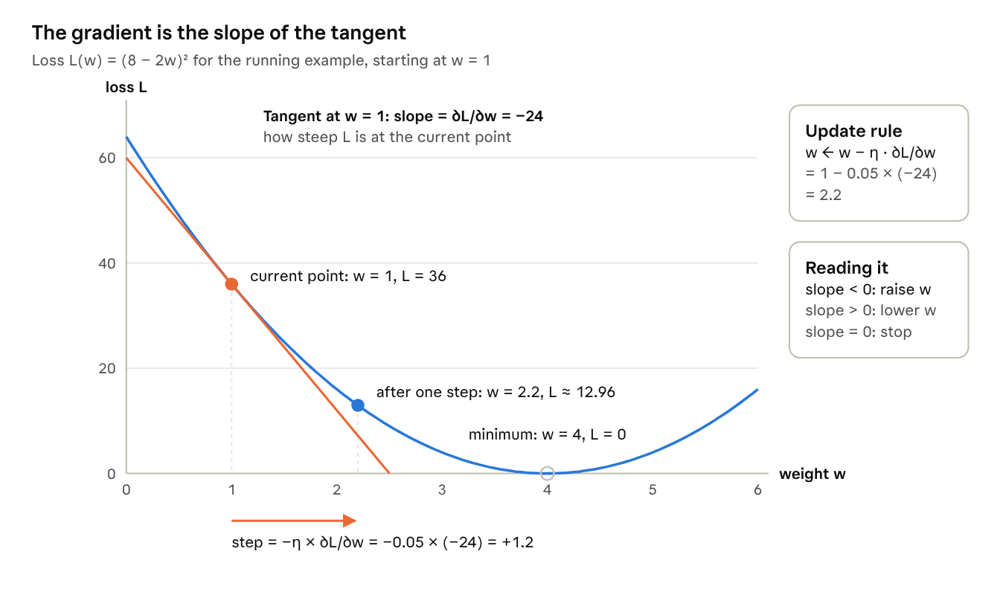

- At w = 1 the tangent slopes downward to the right: its slope is dL/dw = −4(8 − 2w) = −4 × 6 = −24.
- A negative slope means the loss decreases as w increases, so gradient descent moves w to the right. With η = 0.05, the step is −0.05 × (−24) = +1.2, landing at w = 2.2, where the loss has dropped from 36 to about 12.96.
- The step size is proportional to the slope. Far from the minimum the tangent is steep and steps are big. Near the minimum it flattens, so the steps shrink on their own.
- At the minimum (w = 4) the tangent is flat, the gradient is 0, and the weight stops changing.

With many weights, the same picture holds in many dimensions. For example, for a function with two weights, the curve becomes a surface, the tangent line becomes a tangent plane, and the gradient is the list of its slopes in every direction.

For example, in our two-weight case model, the model takes two inputs, x₁ and x₂, with one weight for each:

$$
\hat{y} = w_1 x_1 + w_2 x_2
$$

We train it on two samples. Each sample gives a value for every input, plus its target value y:

| Sample | x₁ | x₂ | y |
| --- | --- | --- | --- |
| 1 | 1 | 2 | 7 |
| 2 | 2 | 3 | 12 |

The number of samples has nothing to do with the number of inputs, we used two here for convenience. This model always has two inputs, but it could be trained on 1 sample or 10,000. This example is small enough that we can spot the best weights by eye: w₁ = 3 and w₂ = 2 predict both target values exactly (3·1 + 2·2 = 7 and 3·2 + 2·3 = 12). The model doesn't know that, and has to find them through training.

**The formulas.** Write sample i's inputs as x₁,ᵢ and x₂,ᵢ and its target value as yᵢ. The model's prediction for it, and the RSS over all n samples, are:

$$
\hat{y}_i = w_1 x_{1,i} + w_2 x_{2,i}, \qquad L(w_1, w_2) = \sum_{i=1}^{n} \left(y_i - \hat{y}_i\right)^2
$$

With two weights, the gradient is a vector with two entries, one per weight: ∇L = \[∂L/∂w₁, ∂L/∂w₂\]. Each entry is worked out separately:

$$
\begin{aligned}
\frac{\partial L}{\partial w_1} &= -2 \sum_{i=1}^{n} x_{1,i}\thinspace (y_i - \hat{y}_i) \cr 
\frac{\partial L}{\partial w_2} &= -2 \sum_{i=1}^{n} x_{2,i}\thinspace (y_i - \hat{y}_i)
\end{aligned}
$$

Each sample contributes its residual, multiplied by its own value of that weight's input. This is the same formula as the running example's dL/dw = −2x(y − ŷ), now summed over samples, once per weight.

**Substituting the samples.** With the two samples in the table and the starting weights w₁ = 1, w₂ = 0.5:

$$
\begin{aligned}
\hat{y}_1 &= 1 \cdot 1 + 0.5 \cdot 2 = 2, \qquad \hat{y}_2 = 1 \cdot 2 + 0.5 \cdot 3 = 3.5 \cr 
L &= (7 - 2)^2 + (12 - 3.5)^2 = 25 + 72.25 = 97.25 \cr 
\frac{\partial L}{\partial w_1} &= -2\thinspace \big[\thinspace 1 \cdot (7 - 2) + 2 \cdot (12 - 3.5)\thinspace \big] = -2\thinspace (5 + 17) = -44 \cr 
\frac{\partial L}{\partial w_2} &= -2\thinspace \big[\thinspace 2 \cdot (7 - 2) + 3 \cdot (12 - 3.5)\thinspace \big] = -2\thinspace (10 + 25.5) = -71
\end{aligned}
$$

Both predictions are far too low (the target values are 7 and 12), so both slopes are negative: raising either weight lowers the loss. With a learning rate of η = 0.01, one update gives:

$$
\begin{aligned}
w_1 &\leftarrow 1 - 0.01 \cdot (-44) = 1.44 \cr 
w_2 &\leftarrow 0.5 - 0.01 \cdot (-71) = 1.21
\end{aligned}
$$

The new predictions are 3.86 and 6.51, and the loss falls from 97.25 to about 40.

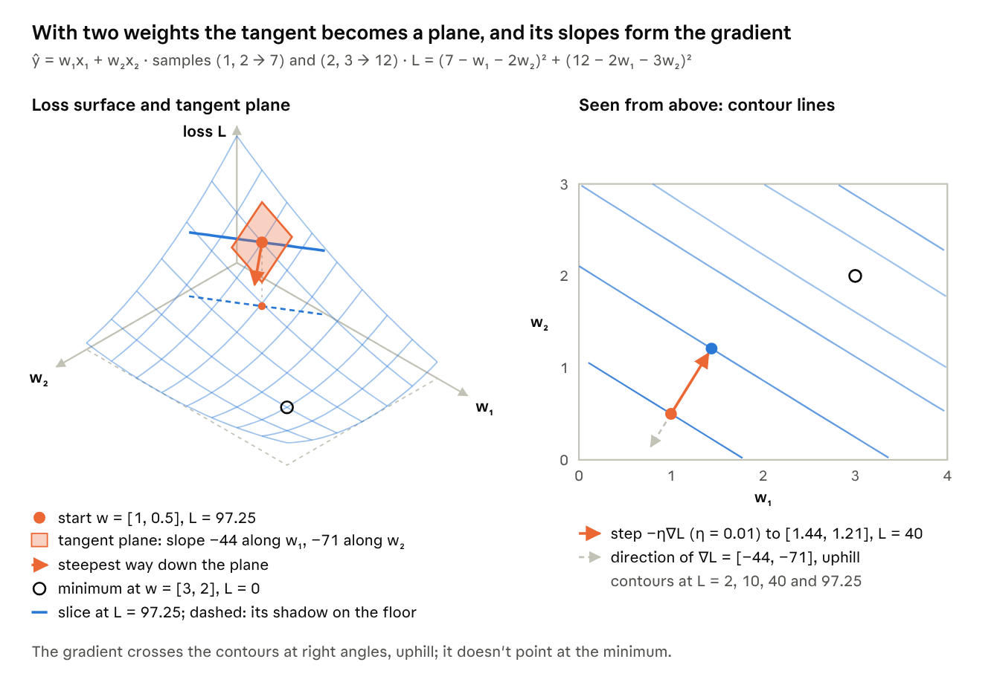

- **Left:** the loss is now a surface over the two weights. The tangent plane touches it at the starting point. Its tilt in the w₁ direction is ∂L/∂w₁ = −44 and in the w₂ direction ∂L/∂w₂ = −71. Together those two slopes are the gradient: ∇L = \[∂L/∂w₁, ∂L/∂w₂\] = \[−44, −71\].
- **Right:** the same surface seen from above. In the left picture, w₁ and w₂ run along the floor and the loss L is the height. Slice the surface at a fixed height, such as L = 97.25 (the solid line through the start point), and drop that slice straight down onto the floor (the dashed line). It joins all the weight pairs that give that same loss. Looking down from above, those dropped slices are the contour lines on the right. Here they are long and almost straight: you can move along one, raising w₁ and lowering w₂ together, without the loss changing. The gradient points at right angles to the contours, straight uphill, which is not towards the minimum at \[3, 2\]. Gradient descent steps the opposite way, from \[1, 0.5\] to \[1.44, 1.21\].
- **The learning rate.** The gradient gives the direction of each step; the learning rate η sets how far to go. Too small and training crawls; too large and the step overshoots the bottom of the valley, so the loss can go up instead of down. The learning rate section below covers how it is chosen.
- With millions of weights we can't draw the surface any more, but the arithmetic is exactly the same: one slope per weight, and every weight steps against its own slope.

### The update rule

Every step of gradient descent applies the same simple rule to every weight:

$$
\text{new weight} = \text{old weight} - \text{learning rate} \times \text{gradient}
$$

or, in symbols:

$$
w \leftarrow w - \eta \thinspace  \frac{\partial L}{\partial w}
$$

- If the gradient is positive (increasing the weight raises the loss), the weight goes down.
- If the gradient is negative (increasing the weight lowers the loss), the weight goes up.
- If the gradient is near zero, we're on flat ground, and the weight barely changes.

### The learning rate

The **learning rate** (η, "eta") is the step size. It is one of the most important settings in training:

- **Too small:** progress is painfully slow, and training may take forever.
- **Too large:** you overshoot the bottom, bounce from side to side, and the loss can even grow out of control.
- **Just right:** the loss drops steadily and settles.

Typical values are small, such as 0.1, 0.01 or 0.001, and are usually found by experimenting.

### Back to the original example

Now we can run gradient descent on the model from section 1. Every step applies the same three formulas: the forward pass and loss, the gradient we derived in the derivative refresher, and the update rule:

$$
\begin{aligned}
\text{Forward: } & \hat{y} = w x, \qquad L = (y - \hat{y})^2 \cr 
\text{Gradient: } & \frac{dL}{dw} = -2x\thinspace (y - \hat{y}) \cr 
\text{Update: } & w \leftarrow w - \eta\thinspace \frac{dL}{dw}
\end{aligned}
$$

Now substitute the sample, x = 2 and y = 8, starting from w = 1 with a learning rate of η = 0.05.

**Step 1** (w = 1)

$$
\begin{aligned}
\hat{y} &= 1 \cdot 2 = 2, \qquad L = (8 - 2)^2 = 36 \cr 
\frac{dL}{dw} &= -2 \cdot 2 \cdot (8 - 2) = -24 \cr 
w &\leftarrow 1 - 0.05 \cdot (-24) = 2.2
\end{aligned}
$$

**Step 2** (w = 2.2)

$$
\begin{aligned}
\hat{y} &= 2.2 \cdot 2 = 4.4, \qquad L = (8 - 4.4)^2 = 12.96 \cr 
\frac{dL}{dw} &= -2 \cdot 2 \cdot (8 - 4.4) = -14.4 \cr 
w &\leftarrow 2.2 - 0.05 \cdot (-14.4) = 2.92
\end{aligned}
$$

At w = 2.92 the prediction is 5.84 and the loss is (8 − 5.84)² ≈ 4.67.

The loss fell from 36 to 12.96 to about 4.67, and w keeps creeping toward 4. Repeat enough times and it gets there.

## 3. Backpropagation

Gradient descent needs the gradient for every weight. A modern network can have millions or billions of weights, so computing each one separately would be hopelessly slow. **Backpropagation** (short for "backward propagation of errors", and usually shortened to backprop, which is what we'll call it from here on) computes all of them in one sweep, at roughly the cost of running the network once more.

### The key idea: the chain rule

A neural network is a chain of simple steps: each layer takes the previous layer's output, transforms it, and passes it on. The **chain rule** from calculus says that when things are linked in a chain, their rates of change multiply.

An everyday version: if a car goes 2 km per minute, and each km uses 0.1 litres of fuel, then fuel use is 2 × 0.1 = 0.2 litres per minute. Backprop does exactly this kind of multiplication, layer by layer.

### Two passes

1. **Forward pass.** Feed an input through the network, layer by layer, to get a prediction. Compute the loss by comparing the prediction to the target value. Along the way, remember the intermediate values each layer produced; they're needed later.
2. **Backward pass.** Start at the loss and work backwards. First find how the loss changes with the final output. Then, using the chain rule, pass that "error signal" back to the previous layer, and the one before it, all the way to the input. At each layer, combine the incoming signal with the values remembered from the forward pass to get the gradient for that layer's weights.

The clever part is reuse: the signal computed for one layer is the starting point for the layer below it, so no work is repeated. That is what makes training large networks practical.

### Credit assignment

Another way to think about backprop: when the network makes a mistake, it figures out how much **blame** each weight deserves. Weights that contributed a lot to the error get large gradients and are adjusted a lot; weights that barely mattered get small gradients and are left mostly alone.

### A worked example: a small two-layer network

To see forward and backward propagation in action, the running example's single layer, single weight isn't enough: there has to be something for the error signal to travel back through. So we grow the network to two layers. We keep it small: one input, a first layer with two neurons, and a second (output) layer with one neuron. With two weights in each layer.

**The network.** The weights sit on the connections between neurons, as in the diagram below. A value travelling along a connection is multiplied by that connection's weight. Each layer's neuron has one incoming connection, from the input, so it receives x times that connection's weight. The output neuron has two incoming connections, one from each hidden neuron, and adds up what arrives along them:

$$
h_1 = w_1 x, \qquad h_2 = w_2 x, \qquad \hat{y} = v_1 h_1 + v_2 h_2, \qquad L = (y - \hat{y})^2
$$

We group the weights by the layer their connections lead into: the two connections into layer 1 carry w = \[w₁, w₂\], and the two connections into layer 2 carry v = \[v₁, v₂\].

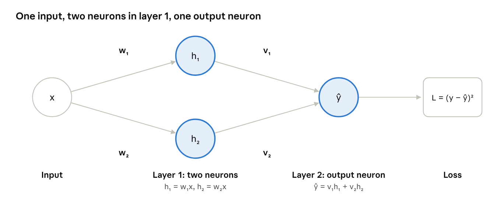

**Local derivatives.** Backprop never needs to understand the whole network at once. It only needs each step's own simple derivative:

- Loss: L = (y − ŷ)², so ∂L/∂ŷ = −2(y − ŷ). The −1 is the derivative of the inside, y − ŷ, with respect to ŷ.
- Output neuron: ŷ = v₁h₁ + v₂h₂, so ∂ŷ/∂v₁ = h₁ and ∂ŷ/∂v₂ = h₂ (for its weights), and ∂ŷ/∂h₁ = v₁ and ∂ŷ/∂h₂ = v₂ (for its inputs).
- Layer 1 neurons: h₁ = w₁x and h₂ = w₂x, so ∂h₁/∂w₁ = x and ∂h₂/∂w₂ = x.

**The gradient, layer by layer.** Each layer gets its own gradient vector, with one entry per weight in that layer, the same shape as the layer's weights. To get an entry, follow the path from the loss back to that weight and multiply every local derivative along the way.

Layer 2 is one step back from the loss:

$$
\frac{\partial L}{\partial v} = \left[\frac{\partial L}{\partial v_1}, \frac{\partial L}{\partial v_2}\right] = \frac{\partial L}{\partial \hat{y}} \cdot [h_1, h_2] = -2(y - \hat{y}) \cdot [h_1, h_2]
$$

Layer 1 is two steps back. First the error signal passes from the output back to each hidden neuron, then on to that neuron's weight:

$$
\begin{aligned}
\frac{\partial L}{\partial h_1} &= \frac{\partial L}{\partial \hat{y}} \cdot v_1, \qquad \frac{\partial L}{\partial h_2} = \frac{\partial L}{\partial \hat{y}} \cdot v_2 \cr 
\frac{\partial L}{\partial w} &= \left[\frac{\partial L}{\partial h_1} \cdot x,\enspace  \frac{\partial L}{\partial h_2} \cdot x\right] = -2(y - \hat{y}) \cdot [v_1 x,\enspace  v_2 x]
\end{aligned}
$$

Together, the two layer vectors make up the full gradient of the network: four numbers, one per weight. Frameworks such as PyTorch store it this way, one gradient per layer with the same shape as that layer's weights.

Notice what each formula needs, and when it becomes available. On **every iteration**:

1. **The forward pass** computes h₁, h₂ and ŷ, and **stores** them. The backward pass can't run without them: h₁ and h₂ are factors in layer 2's gradient, and ŷ is needed for ∂L/∂ŷ.
2. **The backward pass** starts at the loss. It computes ∂L/∂ŷ once, and every entry in both layer gradients uses it. Next it computes ∂L/∂h₁ and ∂L/∂h₂ and reuses them for layer 1, instead of rebuilding each whole product from scratch.

The saving is **within a single backward pass**. Each shared piece, like ∂L/∂ŷ, is computed once per pass and reused by every weight below it. In a deep network, the signal flowing into a layer is reused for all of that layer's weights and passed down to the layers below. That is why backprop works from the output backward. The whole process (forward pass, store values, backward pass, update) repeats every iteration, because the weights change after each update.

**The update rules.** Gradient descent moves each layer's weights against that layer's gradient, with the same learning rate η:

$$
v \leftarrow v - \eta\thinspace \frac{\partial L}{\partial v}, \qquad w \leftarrow w - \eta\thinspace \frac{\partial L}{\partial w}
$$

**Substituting the numbers.** Now take x = 1, target value y = 10, starting weights w = \[2, 1\] and v = \[3, 2\], and a learning rate of η = 0.02.

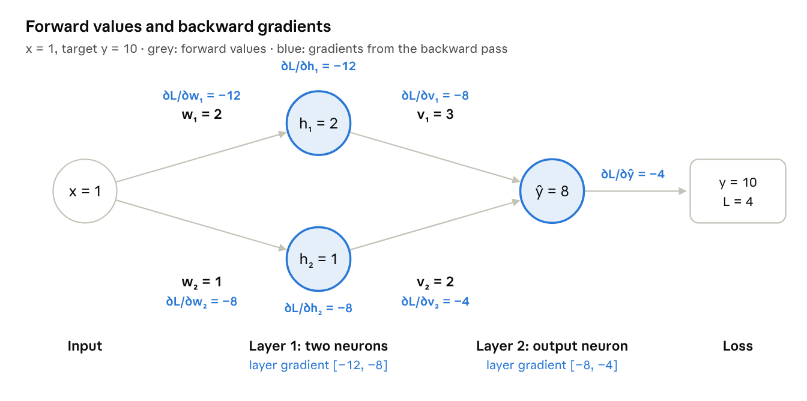

**Forward pass:**

$$
h_1 = 2 \cdot 1 = 2, \qquad h_2 = 1 \cdot 1 = 1, \qquad \hat{y} = 3 \cdot 2 + 2 \cdot 1 = 8, \qquad L = (10 - 8)^2 = 4
$$

**Backward pass**, starting from the loss:

| Quantity | Formula | Value |
| --- | --- | --- |
| ∂L/∂ŷ | −2(y − ŷ) = −2(10 − 8) | −4 |
| ∂L/∂v (layer 2) | ∂L/∂ŷ · \[h₁, h₂\] = −4 · \[2, 1\] | \[−8, −4\] |
| ∂L/∂h₁, ∂L/∂h₂ | ∂L/∂ŷ · \[v₁, v₂\] = −4 · \[3, 2\] | −12, −8 |
| ∂L/∂w (layer 1) | \[∂L/∂h₁ · x, ∂L/∂h₂ · x\] = \[−12 · 1, −8 · 1\] | \[−12, −8\] |

Notice how ∂L/∂ŷ = −4 is computed once and reused for all four weights. That reuse, repeated across many layers, is the whole trick of backprop.

**The update step:**

$$
\begin{aligned}
v &\leftarrow [3, 2] - 0.02 \cdot [-8, -4] = [3.16,\enspace  2.08] \cr 
w &\leftarrow [2, 1] - 0.02 \cdot [-12, -8] = [2.24,\enspace  1.16]
\end{aligned}
$$

Running the forward pass again gives h = \[2.24, 1.16\] and ŷ = 3.16 · 2.24 + 2.08 · 1.16 ≈ 9.49, so the loss drops from 4 to about 0.26.

**A few more rounds.** Repeating forward pass, backward pass and update:

| Round | w | v | Prediction | Loss |
| --- | --- | --- | --- | --- |
| Start | \[2.00, 1.00\] | \[3.00, 2.00\] | 8.00 | 4.00 |
| After 1 | \[2.24, 1.16\] | \[3.16, 2.08\] | 9.49 | 0.26 |
| After 2 | \[2.30, 1.20\] | \[3.21, 2.10\] | 9.92 | 0.007 |
| After 3 | \[2.32, 1.21\] | \[3.21, 2.11\] | 9.99 | 0.0001 |

After three rounds the prediction is very close to the target value of 10.

**Things to notice**

- **Compute every correction first, then update them all.** Each iteration runs in three distinct phases. The forward pass computes and stores h₁, h₂ and ŷ. The backward pass then uses those stored values to compute the gradient for every weight in every layer, while the weights stay exactly as they were. Only once all four gradients are known does the update step change the weights, all together. The order matters: layer 1's gradient uses v₁ and v₂, so if layer 2's weights were updated mid-sweep, layer 1 would be corrected using the wrong values.

  This structure is also why GPUs are so well suited to training. Within each phase the work is the same simple arithmetic repeated over a huge number of values: multiplying each layer's inputs by its weights, multiplying error signals by stored values, and subtracting η × gradient from every weight. A GPU has thousands of small cores that can all do the same operation at once, on different numbers. The layers still have to be processed in order (forward from first to last, backward from last to first), but within a layer, and in the update step, almost everything can happen in parallel.
- **Each layer's gradient has the same shape as its weights.** Each layer here has two weights, so its gradient has two entries. In a real network, where each layer's weights form a matrix, each layer's gradient is a matrix of the same shape.
- **A weight's gradient depends on the layers after it.** Layer 1's entries pass back through v₁ = 3 and v₂ = 2 on their way, which is why they're larger than layer 2's. In deep networks these multiplications stack up across many layers, which is where vanishing and exploding gradients come from.
- **There's more than one right answer.** Any weights with v₁w₁ + v₂w₂ = 10 give a perfect prediction. Gradient descent doesn't search for a special one; it slides downhill to whichever good solution is nearest its starting point.
- **The learning rate matters even here.** With η = 0.05 instead of 0.02, the first step overshoots to a prediction of about 11.9 and the next undershoots to about 7.5, so the loss bounces instead of falling smoothly.

## 4. Activation functions

**Why activations are needed.** Take the smallest two-layer network, with one neuron per layer: layer 1 computes h = w₁x and layer 2 computes ŷ = w₂h. Substitute layer 1 into layer 2:

$$
\hat{y} = w_2 h = w_2 (w_1 x) = (w_2 w_1)\thinspace  x
$$

The two layers collapse into one combined weight, w₂w₁, times x. The same happens to the wider network in section 3, whose prediction works out as ŷ = (v₁w₁ + v₂w₂)x. Stacking layers that only multiply and add always collapses like this into a single straight-line function, however many layers you stack. An **activation function** is a simple non-linear function applied to a neuron's output. It bends the line, and it's what lets networks learn curves and complicated patterns.

**The XOR problem.** A famous example shows what a single straight line can't do. XOR ("exclusive or") takes two inputs that are each 0 or 1, and outputs 1 when exactly one of them is 1:

| x₁ | x₂ | XOR |
| --- | --- | --- |
| 0 | 0 | 0 |
| 0 | 1 | 1 |
| 1 | 0 | 1 |
| 1 | 1 | 0 |

Plot the four inputs as points. The two 1s sit on one diagonal and the two 0s on the other, so no single straight line can put the 1s on one side and the 0s on the other. A single neuron's weighted sum is a straight-line function of its inputs, so it can only draw one straight line, and no choice of weights lets it learn XOR. Stacking layers without an activation doesn't help either: as we just saw, they collapse into a single straight-line function. Marvin Minsky and Seymour Papert made this limitation famous in their 1969 book *Perceptrons* \[1\], and it is often cited as one reason interest in neural networks faded through the 1970s.

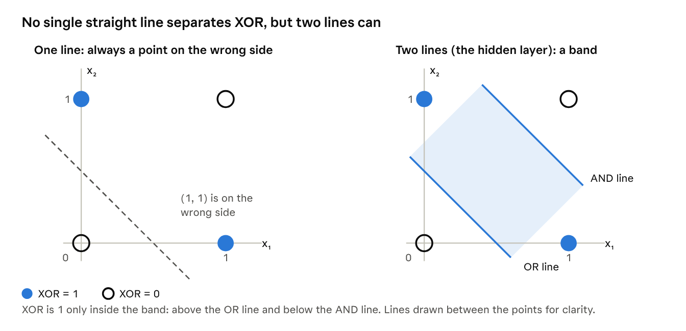

**The fix: a hidden layer with an activation.** Two hidden neurons can each draw one line, and an output neuron can combine them. Here every neuron uses the simplest activation there is, a threshold (or step) function: it outputs 1 if its weighted sum is at least 1, and 0 otherwise:

$$
\text{step}(s) = \begin{cases} 1 & \text{if } s \ge 1 \cr  0 & \text{otherwise} \end{cases}
$$

The network has two hidden neurons, AND and OR, and one output neuron:

$$
\begin{aligned}
h_{\text{AND}} &= \text{step}(0.5 x_1 + 0.5 x_2) \cr 
h_{\text{OR}} &= \text{step}(x_1 + x_2) \cr 
\hat{y} &= \text{step}(h_{\text{OR}} - h_{\text{AND}})
\end{aligned}
$$

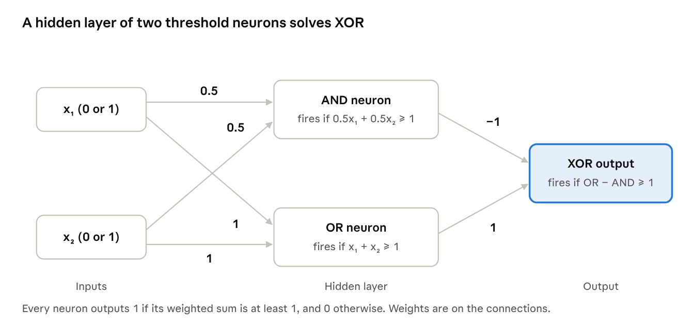

*Network after Figure 4.3 in Kelleher's* Deep Learning *\[12\].*

The AND neuron fires only when both inputs are 1. The OR neuron fires when at least one is. The output fires when OR is on and AND is off, which is exactly XOR. Checking all four inputs:

| x₁ | x₂ | AND: 0.5x₁ + 0.5x₂ → h\_AND | OR: x₁ + x₂ → h\_OR | Output: h\_OR − h\_AND → ŷ | XOR |
| --- | --- | --- | --- | --- | --- |
| 0 | 0 | 0 → 0 | 0 → 0 | 0 → 0 | 0 |
| 0 | 1 | 0.5 → 0 | 1 → 1 | 1 → 1 | 1 |
| 1 | 0 | 0.5 → 0 | 1 → 1 | 1 → 1 | 1 |
| 1 | 1 | 1 → 1 | 2 → 1 | 0 → 0 | 0 |

Without the step, each neuron would just pass on its weighted sum, the three formulas would collapse into one straight-line function again, and XOR would be out of reach. The activation is what lets the two lines drawn by the hidden layer combine into the band in the plot.

**Why it took until the 1980s.** It was known early on that a hidden layer could represent XOR: the weights above were simply picked by hand. What was missing was a way to learn hidden-layer weights from data. Backprop (section 3), popularized by David Rumelhart, Geoffrey Hinton and Ronald Williams in 1986 \[2\], provided it. One catch: the step function is flat everywhere except at its jump, so its slope is 0 and backprop gets no signal through it. That's why trained networks use smooth activations like the ones below.

**Where the activation goes.** It is applied inside every neuron, not once for the whole network. Each neuron does two things. First it multiplies each input by the weight on its connection and adds the results up. A neuron with several inputs sums all of them; in our network each neuron has just one input, so the sum has a single term. This value is called the **pre-activation** z. Then it passes z through the activation function φ (the Greek letter phi) to produce its output h. That output is what travels along the neuron's outgoing connections to the next layer:

$$
z = w_1 x \quad \text{(the pre-activation)}, \qquad h = \varphi(z) \quad \text{(the neuron's output)}
$$

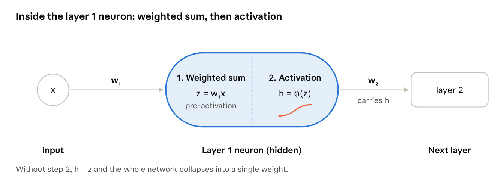

In practice every neuron in the hidden layers does this, usually all with the same activation function. The output layer is often treated differently: for predicting a number, as in our examples, it usually has no activation, and for classification it typically uses softmax (see section 5).

**Common activation functions**

| Name | Formula | Derivative (slope) |
| --- | --- | --- |
| Sigmoid | σ(z) = 1 / (1 + e^(−z)) | σ(z) × (1 − σ(z)) |
| ReLU | max(0, z) | 1 if z > 0, otherwise 0 |
| Tanh | tanh(z) | 1 − tanh(z)² |
| SiLU (Swish) | z × σ(z) | σ(z) × (1 + z × (1 − σ(z))) |

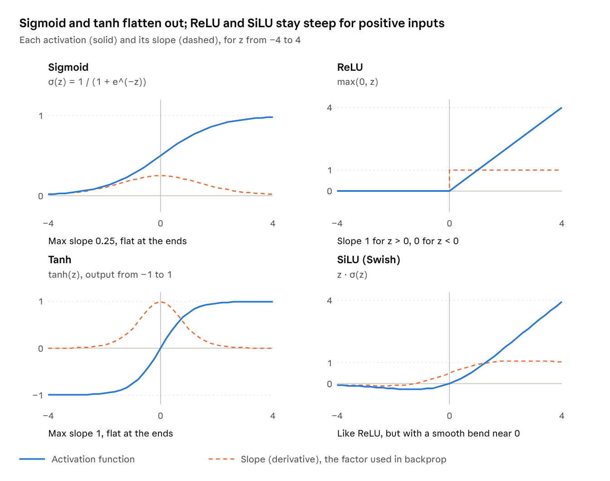

The dashed lines are the slopes, which are the numbers backprop multiplies by. Sigmoid's slope peaks at only 0.25, and tanh's at 1. Both fall towards 0 as z moves away from 0. ReLU's slope is a flat 1 for any positive input and 0 for any negative one. SiLU's slope follows ReLU's: close to 0 for very negative z and close to 1 for large positive z, with a smooth change in between (it even rises slightly above 1).

**The setup.** Now we add an activation to the one-neuron-per-layer network from the start of this section and follow it through a training step. Layer 1 is the hidden layer, so it now gets two parts: first it computes the pre-activation z, then it applies a sigmoid. Layer 2 is the output layer of a network that predicts a number, so it gets no activation, and the loss is unchanged:

$$
z = w_1 x, \qquad h = \sigma(z), \qquad \hat{y} = w_2\thinspace h, \qquad L = (y - \hat{y})^2
$$

**New local derivatives.** The activation adds one link to the chain, and Layer 1's own derivative now refers to z:

$$
\frac{\partial h}{\partial z} = \sigma(z)\thinspace \big(1 - \sigma(z)\big) = h\thinspace (1 - h), \qquad \frac{\partial z}{\partial w_1} = x
$$

A handy property of the sigmoid: its derivative can be computed from the stored h alone, with no need to recompute σ.

**The chain-rule formulas.** w₂ sits after the activation, so its formula has the same form as layer 2's gradient in section 3. w₁ is now three steps back, through h and z:

$$
\begin{aligned}
\frac{\partial L}{\partial w_2} &= \frac{\partial L}{\partial \hat{y}} \cdot \frac{\partial \hat{y}}{\partial w_2} = -2(y - \hat{y}) \cdot h \cr 
\frac{\partial L}{\partial w_1} &= \frac{\partial L}{\partial \hat{y}} \cdot \frac{\partial \hat{y}}{\partial h} \cdot \frac{\partial h}{\partial z} \cdot \frac{\partial z}{\partial w_1} = -2(y - \hat{y}) \cdot w_2 \cdot h(1 - h) \cdot x
\end{aligned}
$$

Compared with a network without an activation, the only change is one extra factor, ∂h/∂z: the activation's derivative, slotted into the chain exactly where the activation sits in the network.

**Substituting the numbers.** Now take x = 1, target value y = 2, starting weights w₁ = 0.5 and w₂ = 2, and a learning rate of η = 0.5.

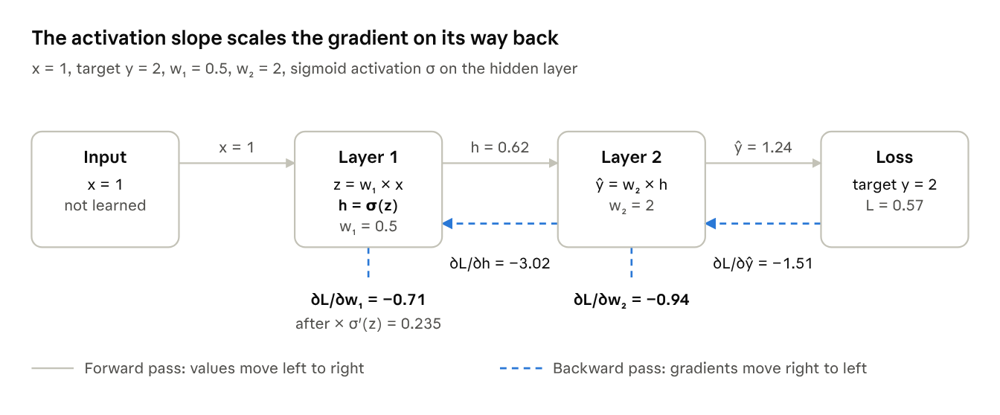

**Forward pass** (the values are stored for the backward pass):

$$
\begin{aligned}
z &= 0.5 \cdot 1 = 0.5 \cr 
h &= \sigma(0.5) \approx 0.6225 \cr 
\hat{y} &= 2 \cdot 0.6225 \approx 1.2449 \cr 
L &= (2 - 1.2449)^2 \approx 0.5701
\end{aligned}
$$

**The activation's slope** at this point, from the stored h:

$$
\frac{\partial h}{\partial z} = h(1 - h) = 0.6225 \cdot 0.3775 \approx 0.2350
$$

**Backward pass**, starting from the loss:

| Quantity | How it's computed | Value |
| --- | --- | --- |
| ∂L/∂ŷ | −2 × (2 − 1.2449) | −1.5102 |
| ∂L/∂w₂ | ∂L/∂ŷ × h = −1.5102 × 0.6225 | −0.9400 |
| ∂L/∂h | ∂L/∂ŷ × w₂ = −1.5102 × 2 | −3.0203 |
| ∂L/∂z | ∂L/∂h × ∂h/∂z = −3.0203 × 0.2350 | −0.7098 |
| ∂L/∂w₁ | ∂L/∂z × x = −0.7098 × 1 | −0.7098 |

**The update step** (learning rate 0.5):

$$
\begin{aligned}
w_2 &\leftarrow 2 - 0.5 \cdot (-0.9400) = 2.47 \cr 
w_1 &\leftarrow 0.5 - 0.5 \cdot (-0.7098) \approx 0.855
\end{aligned}
$$

**A few more rounds:**

| Round | w₁ | w₂ | Prediction | Loss |
| --- | --- | --- | --- | --- |
| Start | 0.50 | 2.00 | 1.245 | 0.570 |
| After 1 | 0.85 | 2.47 | 1.733 | 0.071 |
| After 2 | 0.99 | 2.66 | 1.939 | 0.0037 |
| After 3 | 1.03 | 2.70 | 1.988 | 0.0001 |

**Things to notice**

- **The activation's slope multiplies the gradient.** Here σ′(z) = 0.235 shrank the signal from −3.02 at h to −0.71 at z, before it reached w₁.
- **Sigmoid causes vanishing gradients.** Its slope is never more than 0.25 (at z = 0), and it is close to 0 when z is very positive or very negative. Stack ten sigmoid layers and the gradient can be multiplied by 0.25 or less ten times, leaving under a millionth of the original signal. The early layers barely learn.
- **ReLU avoids most of this.** Its slope is exactly 1 when z > 0, so the gradient passes through unchanged. That's a big reason ReLU is the usual default in deep networks.
- **ReLU's catch is "dead" neurons.** When z < 0, ReLU outputs 0 and its slope is 0, so no gradient flows back. If w₁ had started at −0.5 with a ReLU here, z would be −0.5, ∂h/∂z would be 0, ∂L/∂w₁ would be 0, and w₁ would never move.
- **SiLU softens the corner.** SiLU (also called Swish) multiplies z by its own sigmoid: SiLU(z) = z × σ(z). For large positive z, σ(z) is close to 1, so SiLU(z) ≈ z, like ReLU. For large negative z, σ(z) is close to 0, so SiLU(z) ≈ 0, also like ReLU. Near 0 it bends smoothly instead of switching sharply, and for negative z its slope is small but not exactly 0, so a little gradient still flows back. LLaMA uses it inside its feed-forward networks (section 5).

## 5. From one prediction to a real training sample

**What changes.** In the earlier examples, each sample gave a single prediction and a single loss, whether it had one input (x) or two (x₁ and x₂, as in section 2 and the XOR network). A language model (LLM) is trained on text samples instead, and a single sample gives many predictions at once: one for every token the model has to predict.

**Terms used from here on.** This section follows one journey. Each token position in the text starts with a 4,096-number vector, its embedding, and that vector is transformed block by block as it travels up through the model; at the end it is turned into a score for every possible next token. Along the way, each block makes some helper vectors that it uses to work out how to update the main vector. To keep things precise, these are the exact terms used from here on (sizes are for LLaMA-7B, our reference model).

The main journey:

| Term | Meaning | Size | How long it lasts |
| --- | --- | --- | --- |
| vocabulary | the fixed list of every token the tokenizer knows, each with its own id. It is built once, before training | 32,000 entries | fixed: never changes |
| token | a piece of text from the vocabulary, such as ▁Paris |  | comes with the training sample |
| token id | the token's number in the vocabulary, such as 3681 | 1 number | fixed by the vocabulary |
| position | one slot in the sequence of tokens in the training sample, 1 to n |  | one sample |
| embedding | the learned vector for a token id: one row of the embedding matrix, which has one row per vocabulary entry | 4,096 | **model weight:** all of training, nudged at every update |
| main vector | the vector each position carries through the model. It starts as a copy of the learning embedding, and every block adds its updates to it | 4,096 | one forward pass |
| logits | a score for every token in the vocabulary for the token sequence, computed from the final main vector | 32,000 | one forward pass |
| probabilities | the logits after the softmax | 32,000 | one forward pass |
| target | the token that really comes next at a position |  | comes with the sample |

The helpers, made inside each block and used only to compute that block's update:

| Term | Meaning | Size | How long it lasts |
| --- | --- | --- | --- |
| W\_Q, W\_K, W\_V | the matrices that make queries, keys and values, one set per head in every block | 4,096 × 128 each | **model weights:** all of training, nudged at every update |
| query, key, value | three vectors made from a position's main vector with W\_Q, W\_K and W\_V, separately in each head | 128 each, per head | one forward pass |
| relevance score z\_ij | how well position i's query matches token j's key | 1 number per pair | one forward pass |
| attention weights | position i's relevance scores after the softmax: the proportions of the blend, adding up to 1 | n numbers | one forward pass |
| attention output | the blend of the value vectors, mixed in the attention-weight proportions | 128 per head, then 4,096 | one forward pass |
| feed-forward output | the feed-forward network's result, also added to the main vector | 4,096 | one forward pass |

One word needs care: "weights". We always say **attention weights** for the blend proportions above, which are recomputed for every sample, and **model weights** for the learned numbers (the embeddings, W\_Q, W\_K, W\_V, the feed-forward and output matrices), which only training changes.

The last column is worth a second look. **Model weights** last for the whole of training and change only at the update step; **everything computed during a forward pass** is made from scratch for each sample and then thrown away. For example, the embedding for ▁Paris is a stored row of the embedding matrix. Each sample that contains ▁Paris reads that row as it currently is, and after the sample's backward pass the row is nudged a little, so the next sample reads a slightly improved version. In our Alpaca step the matrix starts from LLaMA's pretrained values. The main vector of the position reading ▁Paris, on the other hand, starts as a copy of that row, is updated block by block during the forward pass, and is gone once the sample is done.

LLMs are usually trained in stages. First comes **pretraining** on huge amounts of plain text, where every sample is simply a chunk of text. Then comes **instruction tuning** (also called supervised fine-tuning), where every sample is an example of a request and a good answer. These samples are stored in a few common formats:

- **Alpaca:** one request and one answer, in three fields: instruction, input and output.
- **ShareGPT:** a whole conversation, stored as a list of turns, each marked as coming from the human or from the model.
- **Chat messages:** also a list of turns, each with a role (system, user or assistant) and its content. Most chat APIs and training libraries use this form.

We'll use Alpaca \[5\], the simplest: one request, one answer. Let's follow a single Alpaca sample through one training step of a language model. The batch contains only this one sample.

**The sample.** An Alpaca record has three fields: **instruction** (the request), **input** (optional extra context, often empty) and **output** (the answer the model should learn to give). Here is one concrete record, as it is stored in the dataset:

```json
{
  "instruction": "Name the capital of France.",
  "input": "",
  "output": "The capital of France is Paris."
}
```

**Step 1: Format and tokenize.** The model never sees separate fields like the ones above: all it ever reads is one continuous piece of text. So the first step is to reformat each raw record from the dataset into a single text, using a fixed prompt template that every sample shares. The Alpaca template is a short preamble, then an "### Instruction:" header followed by the instruction, then a "### Response:" header followed by the output. (When a record's input isn't empty, it gets its own "### Input:" section in between.)

Filled in, the template for our sample looks like this. The instruction field goes under "### Instruction:", and the output field becomes the text under "### Response:". During tokenization, which is the next step, two special markers are also added: \<s> (beginning of sequence) at the very start, and \</s> (end of sequence) right after the response, so the model also learns when to stop:

```
<s>Below is an instruction that describes a task. Write a response that appropriately completes the request.

### Instruction:
Name the capital of France.

### Response:
The capital of France is Paris.</s>
```

Next, the whole text is split into tokens (words and word pieces), and each token is mapped to an integer id from the model's vocabulary, which has tens of thousands of entries.

**Tokenizers: how text becomes numbers.** A model can't read letters; it reads integer ids. A **tokenizer** is a fixed lookup, built before the model is trained, that cuts text into pieces from a fixed vocabulary and maps each piece to an id. There are three broad approaches:

- **Word-level:** one token per word. Simple, but the vocabulary becomes enormous, and any word not in it becomes an "unknown" token.
- **Character-level:** one token per character. The vocabulary is tiny and nothing is ever unknown, but sequences get very long and each token carries little meaning.
- **Subword (what modern language models use):** common words are a single token, and rare words are split into reusable pieces. For example, "tokenization" might become "token" + "ization". This keeps the vocabulary manageable while still being able to spell anything.

One of the most popular subword algorithms is **BPE (Byte-Pair Encoding)** \[6\], used by OpenAI's GPT models, including ChatGPT. We'll use it to illustrate the idea. BPE builds its vocabulary in a separate step, once, before the model is ever trained. It scans a large sample of text, collected just for building the tokenizer: it starts from single characters (or bytes) and repeatedly merges the most frequent neighboring pair into a new token. GPT-2 \[7\] uses a byte-level BPE with 50,257 tokens; newer OpenAI models use larger BPE vocabularies of around 100,000 or more.

**A tiny BPE run.** Take a toy tokenizer text with five words, each appearing a number of times: hug ×10, pug ×5, pun ×12, bun ×4, hugs ×5. Split every word into single characters. Each round, count every neighboring pair across all the words, merge the most frequent pair everywhere, and add it to the vocabulary:

| Round | Pair merged | Count | Words after the merge | Added to the vocabulary |
| --- | --- | --- | --- | --- |
| Start | none |  | h u g, p u g, p u n, b u n, h u g s | b, g, h, n, p, s, u |
| 1 | u + g | 10 + 5 + 5 = 20 | h **ug**, p **ug**, p u n, b u n, h **ug** s | ug |
| 2 | u + n | 12 + 4 = 16 | h ug, p ug, p **un**, b **un**, h ug s | un |
| 3 | h + ug | 10 + 5 = 15 | **hug**, p ug, p un, b un, **hug** s | hug |

In round 1, u + g (20) beats p + u (17) and h + u (15). A real tokenizer keeps going for tens of thousands of rounds, until the vocabulary reaches its chosen size.

To tokenize new text, BPE works from small to large, just as it did when learning: it splits each word into single characters, then replays the learned merges in the order they were learned (u + g, then u + n, then h + ug), applying each one wherever it fits. For "hugs": h u g s → h ug s → hug s. In the same way, "bug", which never appeared in the tokenizer text, becomes b + ug. Any word can be spelled from known pieces.

Other popular subword algorithms:

- **WordPiece** also merges pieces, but picks the merges that most improve how well the vocabulary fits the training text. BERT \[8\] uses it, with about 30,000 tokens, marking word continuations with "##" (so "playing" might be "play" + "##ing").
- **Unigram** works the other way round: it starts with a very large vocabulary and prunes the pieces that matter least \[9\]. T5 uses it.
- **SentencePiece** is a library \[10\] that runs BPE or Unigram directly on raw text, treating the space as an ordinary symbol, written "▁". LLaMA \[4\], the base model Alpaca was fine-tuned from, uses a SentencePiece BPE tokenizer with 32,000 tokens and *byte fallback*: anything not in the vocabulary is spelled out byte by byte, so nothing is ever unknown.

*Two practical consequences: **a model and its tokenizer are a matched pair** (swap the tokenizer and the ids mean nothing), and the vocabulary size directly sets the size of the model's embedding matrix and output layer.*

**An excerpt from the vocabulary.** A SentencePiece vocabulary like LLaMA's looks roughly like this. The special tokens at ids 0 to 2 are LLaMA's; the other ids are illustrative, because exact numbers differ between tokenizers.

| Id | Token | What it is |
| --- | --- | --- |
| 0 | \<unk> | Unknown (rarely used, thanks to byte fallback) |
| 1 | \<s> | Beginning of sequence |
| 2 | \</s> | End of sequence |
| 3 to 258 | <0x00> … <0xFF> | The 256 single bytes, used as a fallback |
| 278 | ▁the | A whole word; ▁ means "preceded by a space" |
| 450 | ▁The | Capitalized words are separate tokens |
| 310 | ▁of | A whole word |
| 338 | ▁is | A whole word |
| 7483 | ▁capital | A whole word |
| 3444 | ▁France | A whole word |
| 3681 | ▁Paris | A whole word |
| 2799 | ization | A word piece with no leading space, used inside longer words |
| 29889 | . | Punctuation |
| 29901 | : | Punctuation (as in "### Response:") |
| … | … | About 32,000 entries in total |

**The lookup in action.** Here is our response going through the tokenizer. BPE splits the text into pieces from the vocabulary, and each piece is replaced by its id from the table above:

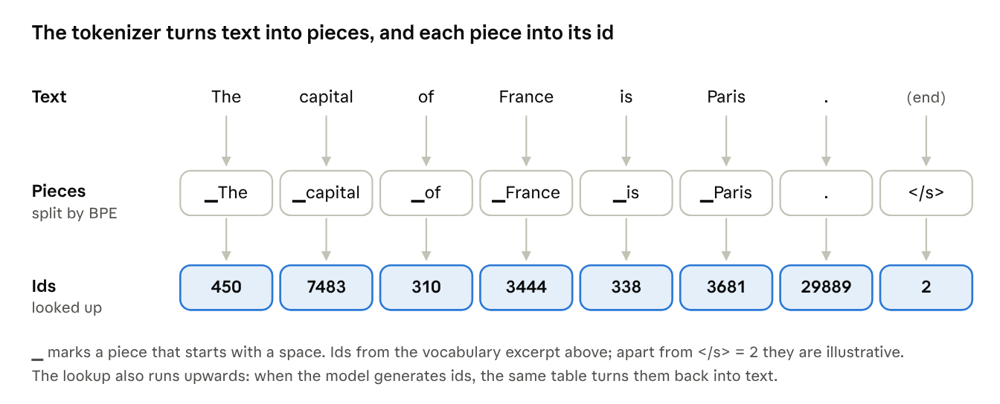

These ids are all the model receives, and on its own an id is just a row number with no meaning. So the first thing the model does is replace each id with a vector for that token, called its **embedding**: in LLaMA-7B, a list of 4,096 numbers. The id simply says which row of a big matrix inside the model to read. So id 3681 is replaced by the 4,096 numbers stored in row 3681, the embedding for ▁Paris, and from then on the model works only with these vectors. Unlike the tokenizer's lookup above, which is fixed once it's built, the numbers in this matrix are weights that are learned during training. We'll look at embeddings more closely in Step 4 (② Embedding).

**Step 2: Inputs and targets (teacher forcing).** A language model is trained to predict the next token. So the input is the token sequence, and the target at each position is simply the token that comes next: the same sequence, shifted by one. During training the model always reads the correct earlier tokens, never its own guesses. This is called **teacher forcing**. It means a text of n tokens gives n − 1 predictions, all made in a single forward pass. Here are five positions from the start of our response:

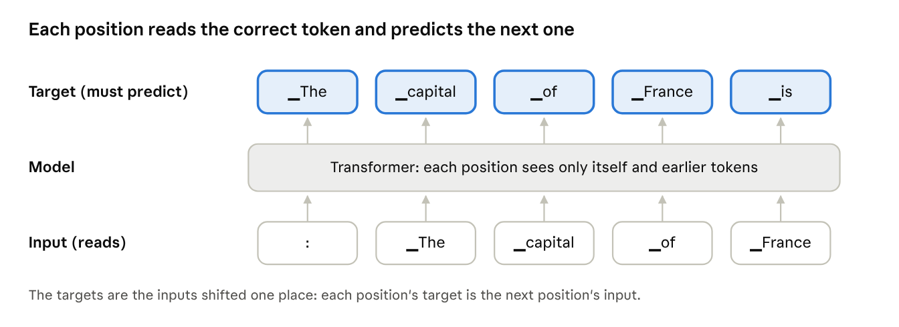

| Position reads | Sees (itself and everything before it) | Must predict |
| --- | --- | --- |
| : | the whole prompt, ending in "### Response:" | ▁The |
| ▁The | the prompt + ▁The | ▁capital |
| ▁capital | the prompt + ▁The ▁capital | ▁of |
| … | … | … |
| . | the prompt + the whole response | end of sequence |

**Step 3: Two different masks.** Two separate things in training are called a "mask". They do different jobs, so it helps to keep them apart.

**The causal mask: what each position can see.** Inside attention (Step 4), each position decides how much to draw on every token in the sequence. To talk about this we need two labels: **i** for the position doing the looking, and **j** for the token it looks at. For each pair, the model works out one number, z\_ij: how relevant token j is to position i. For example, if i is the position reading ▁is and j is ▁France, then z\_ij says how much ▁is should draw on ▁France. Where does z come from? It isn't random, and it isn't one of the model weights: it is computed fresh on every forward pass, from the two tokens' vectors and some learned weight matrices (it is large when the two vectors match well). ③ in Step 4 shows exactly how. For the mask, all that matters is that there is one z for every pair of tokens. This plays the same role as the pre-activation z in section 4: a weighted sum, computed first, and then passed through a function. Here the function is the softmax, which turns all of position i's numbers into attention weights that add up to 1. The causal mask sets z\_ij to minus infinity for every token that comes after position i (j > i), hence masks them before the softmax is applied:

$$
\begin{aligned}
\text{weight}_{ij} &= \frac{e^{z_{ij}}}{e^{z_{i1}} + e^{z_{i2}} + \dots + e^{z_{in}}} \cr 
z_{ij} = -\infty \text{ for } j > i \quad &\Rightarrow \quad e^{-\infty} = 0 \quad \Rightarrow \quad \text{weight}_{ij} = 0
\end{aligned}
$$

Here n is the number of tokens in the sequence, so the bottom of the fraction adds up e^z for every token. The softmax acts like an activation applied to all of position i's z values together: e^z makes every value positive (and favors the larger ones strongly), and dividing by their sum makes the weights add up to 1. A z of minus infinity gives e^z = 0, which adds nothing to the sum, so the remaining weights still add up to 1.

One more ingredient first. Besides its embedding, every token also gets a second vector inside attention, called its **value**: the information that token passes on to any position that pays attention to it. We'll return to it in Step 4; for now, just keep in mind that in LLaMA-7B, the model we're using as our reference, each *value vector* has 128 numbers. Here is the whole calculation for one position, the one reading ▁is. Each token it can see gets a z, the softmax turns those into attention weights, and the position's attention output is the blend of those tokens' value vectors, mixed in those proportions. The masked token, ▁Paris, gets an attention weight of exactly 0:

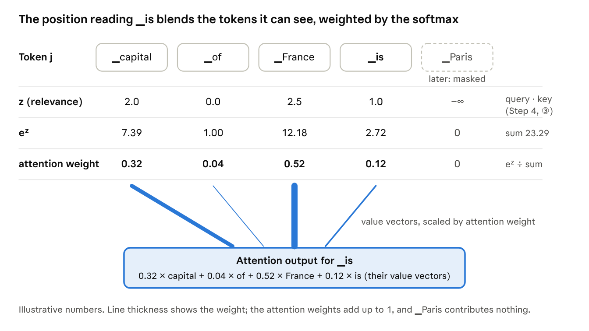

**How the blend is multiplied.** Each attention weight is a single number, and each token's value vector is a list of d numbers. So 0.32 × capital means: multiply every number in ▁capital's value vector by 0.32. The four scaled vectors are then added number by number, giving the attention output: one vector of d numbers. In matrix terms, the five attention weights (all belonging to the position reading ▁is) form one row, and the five value vectors, from the abbreviated example above, are stacked as the rows of a matrix: row 1 is ▁capital's value, row 2 is ▁of's, row 3 is ▁France's, row 4 is ▁is's own, and row 5 is ▁Paris's. Each row comes from a different token:

$$
\text{attention weights}\thinspace [1 \times 5] \cdot \text{values}\thinspace [5 \times d] \enspace \rightarrow\enspace  \text{attention output}\thinspace [1 \times d]
$$

The inner 5 (one per token, ▁Paris included with weight 0) matches and disappears, so the result has the same length (d) as one value vector.

In shot, a position gets no information at all from any later token. Without this, the position reading ▁is could look one step ahead, see ▁Paris, and simply copy it. For four tokens of our sample:

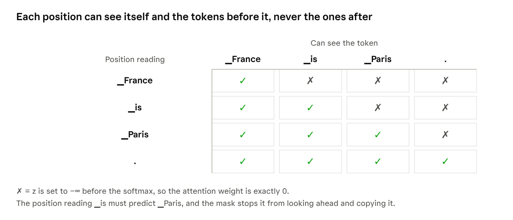

The whole sequence still goes through as one matrix, but each position behaves as if the tokens after it don't exist. That is also exactly the situation the model faces later when it generates text, one token at a time.

**The loss mask: which predictions are scored.** We want the model to learn to write responses, not to recite instructions. So every position whose target is part of the prompt gets an "ignore" label (−100 in PyTorch and Hugging Face code). Those positions are still read as context, but their predictions add nothing to the loss. Only positions whose target is part of the response count:

| Position reads | Its target (next token) | Counted in the loss? |
| --- | --- | --- |
| \<s> | ▁Below | No: prompt |
| … (the rest of the prompt) | … | No: prompt |
| ▁Response | : | No: prompt |
| : | ▁The | Yes |
| ▁The | ▁capital | Yes |
| ▁capital | ▁of | Yes |
| ▁of | ▁France | Yes |
| ▁France | ▁is | Yes |
| ▁is | ▁Paris | Yes |
| ▁Paris | . | Yes |
| . | \</s> | Yes |

So, for our full example, only 8 response tokens are scored. In Hugging Face-style code, the loss mask is stored as a `labels` list: *a copy of the token ids in which every prompt token is replaced with −100.* To calculate the loss, this list is shifted one place to the left, so each position's label becomes the next token in the input: its target from Step 2.

**Step 4: Inside the forward pass.** Language models like LLaMA are based on the Transformer, introduced in the 2017 paper "Attention Is All You Need" \[3\]. It is a stack of fairly simple parts. Here is the layout, read from the bottom up; each numbered part is explained below:

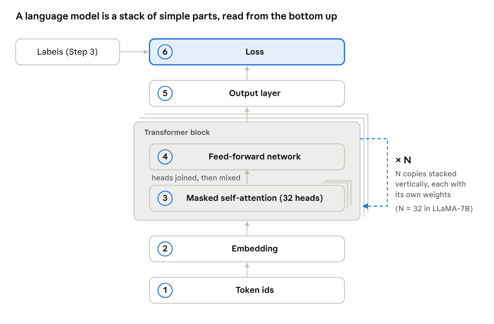

**① Token ids.** The sample from Step 1, as a list of n integer ids, one per token.

**② Embedding.** An id is just a label, with no meaning of its own, so the model first swaps each id for an embedding: a list of numbers (a vector) that stands for that token. The embeddings are weights like any others: they start random, and backprop adjusts them during training, so tokens used in similar ways end up with similar vectors (▁Paris ends up close to ▁London, for example). In practice, each id picks one row from an embedding matrix of size vocabulary × d. In LLaMA-7B that's 32,000 × 4,096, so every token becomes a list of 4,096 numbers: its embedding. On its own, an embedding says nothing about where the token sits in the text: LLaMA adds that information later, inside attention (see "Where position comes in" in ③). The original 2017 Transformer instead added a position pattern straight to each embedding. This embedding becomes the position's main vector, which every block then updates.

**A lookup table, then a matrix.** Getting from text to a vector takes two separate steps, and it's worth keeping them apart: the tokenizer's vocabulary is a lookup table, while the embeddings are the rows of a matrix of model weights:

|  | Tokenizer vocabulary | Embedding matrix |
| --- | --- | --- |
| What it maps | piece → id | id → vector (the embedding) |
| Size in LLaMA-7B | 32,000 entries | 32,000 rows × 4,096 numbers, about 131 million |
| How it's made | built once by BPE, before training | weights: random at the start of pretraining, then learned by backprop |
| Changes during training? | never | yes, at every update |

The width of each row, d = 4,096 in LLaMA-7B, is a design choice: GPT-2's smallest model uses 768, and bigger models use more. For our sample, the whole chain for one word is:

$$
\text{"Paris"} \enspace \rightarrow\enspace  \text{▁Paris} \enspace \rightarrow\enspace  \text{id } 3681 \enspace \rightarrow\enspace  \text{row } 3681 \enspace \rightarrow\enspace  [\thinspace 4096 \text{ numbers}\thinspace ]
$$

**How close is "close"?** Two embeddings are compared by the direction they point in, not by their length. The usual measure is **cosine similarity**: the cosine of the angle θ between the two vectors a and b. It is built from two simpler pieces.

**The dot product** of two vectors multiplies them number by number and adds up the results:

$$
a \cdot b = a_1 b_1 + a_2 b_2 + \dots + a_d b_d
$$

For example, \[3, 1\] · \[3, 2\] = 3 × 3 + 1 × 2 = 11. It is large when the two vectors have large numbers in the same places, so it grows both with how well they line up and with how long they are.

**The length** of a vector is the square root of its dot product with itself:

$$
\lVert a \rVert = \sqrt{a \cdot a} = \sqrt{a_1^2 + a_2^2 + \dots + a_d^2}
$$

For example, the length of \[3, 1\] is √(9 + 1) = √10 ≈ 3.16.

**Cosine similarity** divides the dot product by both lengths. That cancels out how long the vectors are and leaves only how well their directions agree:

$$
\cos\theta = \frac{a \cdot b}{\lVert a \rVert \thinspace  \lVert b \rVert}
$$

This is the same as first **normalizing** each vector, meaning dividing it by its own length so that its length becomes 1, and then taking the dot product of the two normalized vectors. Either way, only the directions count.

**What a cosine is.** If trigonometry is a distant memory, here is all we need. Put two arrows of length 1 tail to tail, with an angle θ between them, and shine a light straight down onto one of them. The shadow the other arrow casts along it has length **cos θ**, the cosine of the angle. For two length 1 vectors, that shadow is exactly their dot product, which is why normalizing and then taking the dot product measures how much two directions overlap:

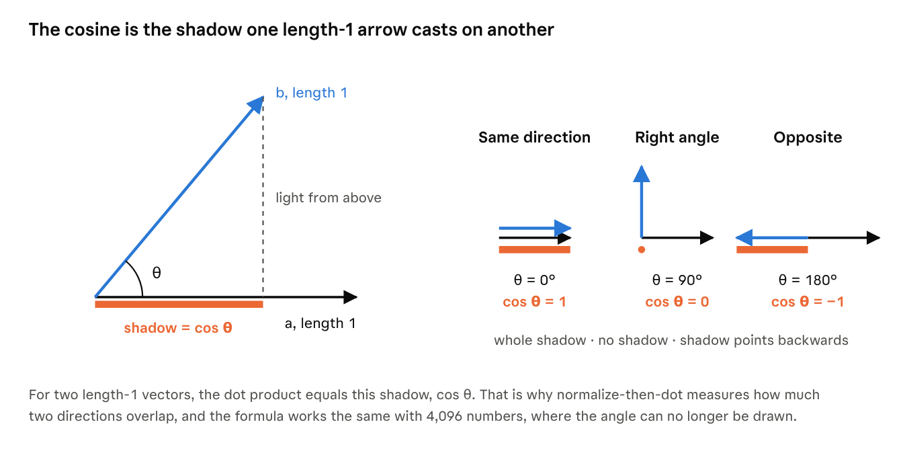

Cosine similarity is 1 when the two vectors point the same way, 0 when they are at right angles (unrelated), and −1 when they point in opposite directions. ***Cosine distance** is simply 1 − cosine similarity*, so a distance of 0 means the same direction. A toy example, with 2 numbers per token instead of 4,096:

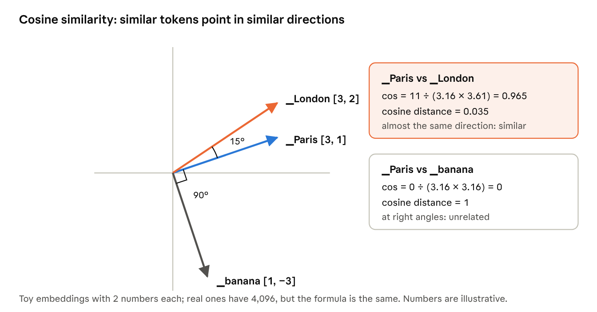

| Pair | Dot product a · b | Lengths ‖a‖ × ‖b‖ | Cosine similarity | Cosine distance |
| --- | --- | --- | --- | --- |
| ▁Paris, ▁London | 3 × 3 + 1 × 2 = 11 | √10 × √13 ≈ 11.40 | 0.965 | 0.035 |
| ▁Paris, ▁banana | 3 × 1 + 1 × (−3) = 0 | √10 × √10 = 10 | 0 | 1 |

The dot product on top of that fraction comes back twice later: attention compares a query with a key using it (③), and the output layer scores each token with it (⑤). Those use the plain dot product, without dividing by the lengths, so there a longer vector can also score higher.

**③ Masked self-attention: where z comes from.** We have already met attention in Step 3: the position reading ▁is gave every token it can see a relevance number z, the softmax turned those numbers into attention weights, and the position got its attention output: a blend of those tokens' value vectors. Two things were left open: where z comes from, and what the values are.

**Query, key and value: what they are.** Every position's main vector (in the first block, that's its embedding from ②) is used to make three helper vectors, each with its own job:

- **Query:** what this position is looking for in the other tokens.
- **Key:** what this token offers, so that queries can find it.
- **Value:** the information this token passes on when a query picks it.

Each one is made the same way: the main vector is multiplied by a weight matrix, W\_Q for queries, W\_K for keys and W\_V for values. Multiplying a vector by a matrix just means taking several weighted sums of its numbers, one per column of the matrix, exactly like the weighted sums in sections 1 to 4. A tiny example, with 3 numbers per token (main) vector and 2 per query:

$$
\begin{aligned}
x &= [1, 0, 2], \qquad W_Q = \begin{bmatrix} 1 & 0 \cr  0 & 1 \cr  1 & 1 \end{bmatrix} \cr 
\text{query} = x\thinspace W_Q &= [\thinspace 1 \cdot 1 + 0 \cdot 0 + 2 \cdot 1,\enspace  1 \cdot 0 + 0 \cdot 1 + 2 \cdot 1\thinspace ] = [3, 2]
\end{aligned}
$$

The key and the value come from the same x, using W\_K and W\_V instead. The same three matrices are used for every token at every position.

**Keeping track of shapes.** Every matrix multiplication in this section follows one rule: an \[a × b\] matrix times a \[b × c\] matrix gives an \[a × c\] result. The inner numbers must match, and they disappear. A vector is just a matrix with one row, so in the toy example x is \[1 × 3\], W\_Q is \[3 × 2\] and the query is \[1 × 2\]. At LLaMA-7B's real size, for one head:

$$
x\thinspace [1 \times 4096] \cdot W_Q\thinspace [4096 \times 128] \enspace \rightarrow\enspace  \text{query}\thinspace [1 \times 128]
$$

The key and the value have the same shape.

**Where the matrix numbers come from.** W\_Q, W\_K and W\_V are weights, just like w₁ and w₂ in sections 1 to 4, and they are learned the same way. A training step treats them identically in both stages of training; only the starting point and the data differ:

|  | Pretraining (from scratch) | Instruction tuning (our Alpaca step) |
| --- | --- | --- |
| Starting values of W\_Q, W\_K, W\_V | random numbers | LLaMA's pretrained matrices |
| Training data | huge amounts of plain text | request-and-answer samples like ours |
| One training step | forward pass, loss, backprop, update | exactly the same |
| What happens to the matrices | they slowly learn to make queries and keys match in useful ways | small nudges on top of what they already do |

So in our Alpaca step the three matrices are already pretrained, and Steps 7 and 8 nudge them a little further, along with every other weight. Nobody decides by hand what a query "looks for": the descriptions in the list above are our way of describing what the trained numbers end up doing.

**Where position comes in.** Comparing a query with a key tells the model how well two tokens match, but nothing in it says where those tokens are. On its own, attention would treat "dog bites man" and "man bites dog" exactly the same. LLaMA fixes this with **rotary position embeddings** (RoPE) \[13\]: before a query and a key are compared, each one is rotated by an amount that depends on its token's position. The rotations are set up so that the relevance score z\_ij depends on how far apart the two tokens are, i − j, rather than on where they sit in the text. That lets the model learn patterns like "the token just before me" that work anywhere in a sequence. Only queries and keys are rotated; values are left as they are. Appendix A shows how the rotation works.

**From query and key to z.** z\_ij measures how well position i's query matches token j's key, using a dot product, which is large when the two vectors point the same way. The values are what gets blended. Written for all positions at once:

$$
\text{Attention}(Q, K, V) = \text{softmax}\left( \frac{Q K^{\top}}{\sqrt{d_k}} \right) V
$$

- **QKᵀ:** every query dotted with every key, one number for each pair (i, j).
- **÷ √d\_k:** d\_k is the length of the key vectors. Dividing by its square root keeps the numbers from growing so large that the softmax becomes all-or-nothing, which would stall training. The result is the z\_ij from Step 3.
- **softmax:** turns each position's z values into attention weights that add up to 1, exactly as in Step 3. The causal mask's −∞ becomes an attention weight of 0 here.
- **× V:** blends the value vectors according to the attention weights, giving each position its attention output.

In shapes, for one head: a single z is a query times a key turned on its side (written kᵀ, "k transposed", a row turned into a column so the rule applies), and the blend is the row of weights times the stacked values:

$$
\begin{aligned}
z_{ij} &= q_i\thinspace [1 \times 128] \cdot k_j^{\top}\thinspace [128 \times 1] \enspace \rightarrow\enspace  [1 \times 1], \text{ a single number} \cr 
\text{attention output}_i &= \text{attention weights}\thinspace [1 \times n] \cdot V\thinspace [n \times 128] \enspace \rightarrow\enspace  [1 \times 128]
\end{aligned}
$$

For all n positions at once, QKᵀ is \[n × 128\] · \[128 × n\] → \[n × n\]: one z for every pair, which is exactly the grid the causal mask works on.

In the Step 3 diagram (illustrative numbers), the query of the position reading ▁is matched the keys of ▁France and ▁capital best, so their values made up most of the blend. That's exactly the information needed to predict ▁Paris. Nobody programs this behavior; it comes out of training.

**Several heads, side by side.** Inside ③, attention doesn't run just once. Several attention "heads" run side by side (horizontally, in parallel), all on the same input, each with its own query, key and value matrices, so different heads can track different kinds of relationships. To keep the cost the same, each head works with shorter vectors. LLaMA-7B has 32 heads in each attention part, and each head's query, key and value have 4,096 ÷ 32 = 128 numbers. The 32 heads' results, 32 × 128 = 4,096 numbers, are then joined back together, and one more weight matrix mixes them, giving one attention output per position, 4,096 numbers, the same width as the main vector. It is added to the main vector (the residual connection, below), and the updated main vector goes on to the block's feed-forward network, ④: there is one feed-forward network per block, not one per head.

$$
32 \text{ heads} \times [1 \times 128] \enspace \rightarrow\enspace  [1 \times 4096] \cdot [4096 \times 4096] \enspace \rightarrow\enspace  [1 \times 4096]
$$

**④ Feed-forward network.** A small network applied to each position's main vector separately, with an activation function between its layers, just like the networks in sections 3 and 4. LLaMA's version is called **SwiGLU** \[14\]. It widens the main vector twice, side by side, with two model weight matrices, W\_gate and W\_up. One widened copy goes through the SiLU activation from section 4, and the result multiplies the other copy number by number. That multiplication is the "gate": where the SiLU copy is close to 0 it blocks that number, and where it is far from 0 it lets the number through, scaled. A third matrix, W\_down, narrows the result back to the length of the main vector:

$$
\text{feed-forward output} = \big(\text{SiLU}(x\thinspace  W_{\text{gate}}) \odot (x\thinspace  W_{\text{up}})\big)\thinspace  W_{\text{down}}
$$

Here x is the main vector. The symbol ⊙ multiplies two vectors of the same length number by number: the first number with the first, the second with the second, and so on. For example, with two toy vectors of 3 numbers each, \[1, 2, 3\] ⊙ \[4, 5, 6\] = \[1 × 4, 2 × 5, 3 × 6\] = \[4, 10, 18\]. In LLaMA-7B both vectors have 11,008 numbers.

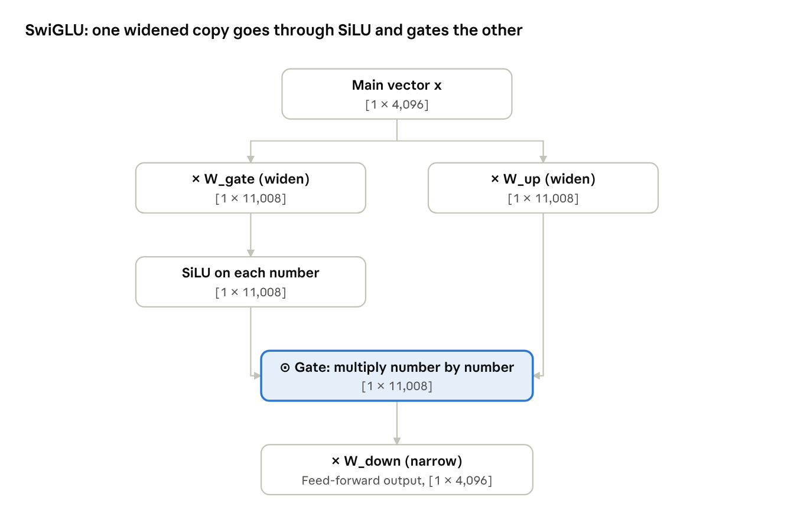

In shapes, each widening matrix turns \[1 × 4,096\] into \[1 × 11,008\], the gate keeps that length, and the narrowing matrix turns it back:

$$
\begin{aligned}
x\thinspace [1 \times 4096] \cdot W_{\text{gate}}\thinspace [4096 \times 11008] &\enspace \rightarrow\enspace  [1 \times 11008] \cr 
x\thinspace [1 \times 4096] \cdot W_{\text{up}}\thinspace [4096 \times 11008] &\enspace \rightarrow\enspace  [1 \times 11008] \cr 
\text{SiLU}(\cdot) \odot (\cdot) &\enspace \rightarrow\enspace  [1 \times 11008] \cr 
[1 \times 11008] \cdot W_{\text{down}}\thinspace [11008 \times 4096] &\enspace \rightarrow\enspace  [1 \times 4096]
\end{aligned}
$$

**Residual connections and normalization** wrap ③ and ④. A residual connection adds a part's output to its input, so each position's main vector is updated rather than replaced: the attention output and the feed-forward output are both added to it. Normalization rescales the numbers to keep them in a steady range. Together they give gradients a short path back through the stack, which is a big part of how these deep networks avoid vanishing gradients.

**Repeated N times.** ③ and ④ together form one Transformer block. Whole blocks are stacked vertically, on top of each other, N times, each copy with its own weights, and the output of one block is the input of the next. In LLaMA-7B, N = 32.

That makes two different kinds of repetition. Heads sit side by side, horizontally, *within* one block's ③, all reading the same input at once. Blocks are stacked vertically, *one after another*, each reading the previous block's output. In LLaMA-7B both numbers happen to be 32, so each of its 32 stacked blocks contains 32 heads. Put together: one block is 32 heads in parallel, joined and mixed, then one feed-forward network; the model is 32 such blocks stacked one on top of the other.

**⑤ Output layer.** After the last block, each position has its final main vector of 4,096 numbers, call it h: everything the model has worked out about what should come next. The output layer turns h into a score for every token in the vocabulary, called a **logit**. It is one big weight matrix with a column of 4,096 weights for each of the 32,000 tokens in LLaMA's vocabulary, because every possible next token needs a score. The logit for token k is the dot product of h with column k:

$$
\text{logit}_k = h_1 w_{1k} + h_2 w_{2k} + \dots + h_{4096} w_{4096,k}
$$

In shapes, for one position:

$$
h\thinspace [1 \times 4096] \cdot W_{\text{out}}\thinspace [4096 \times 32000] \enspace \rightarrow\enspace  \text{logits}\thinspace [1 \times 32000]
$$

That's the same weighted sum as the pre-activation z in section 4, just done 32,000 times, once per token. Each column acts like a learned template for its token: the logit is large when h points the same way as that token's column. The softmax then turns the 32,000 logits into probabilities that add up to 1, playing the part of the activation, applied to all of them together. A toy version, with 3 numbers instead of 4,096 and 4 tokens instead of 32,000:

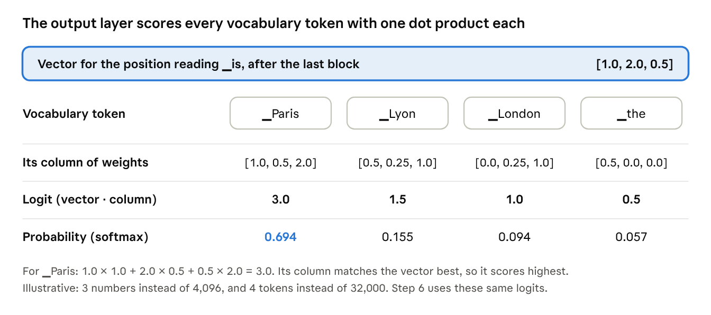

This one layer has 4,096 × 32,000, about 131 million, weights, all learned like any other.

**A closer look at softmax: why not just pick the top token?** The output layer gives 32,000 logits, but training needs probabilities: numbers between 0 and 1 that add up to 1. The obvious choice would be a **hard max**: give the token with the highest logit all of the probability, which is \[1, 0, 0, 0\] in the toy example. Softmax is a softer version. It gives most of the probability to the top token but keeps some for the others: \[0.694, 0.155, 0.094, 0.057\]. That matters for training. A hard max can't tell how close the other tokens came, and nudging a weight slightly almost never changes which token is on top, so its gradient would be 0 and backprop would have nothing to work with. Softmax changes smoothly as the logits change, so every token gets a useful gradient (you'll see it in Step 6).

**How softmax is calculated.** Two steps. First raise e (the number 2.718…) to the power of each logit. Then divide each result by the sum of all of them:

$$
p_k = \frac{e^{\text{logit}_k}}{e^{\text{logit}_1} + e^{\text{logit}_2} + \dots + e^{\text{logit}_{32000}}}
$$

The first step makes every value positive, even for a negative logit, and keeps the order: a bigger logit always gets a bigger share. The second step makes the shares add up to 1. With the toy logits:

| Token | Logit | e^logit | p = e^logit ÷ 28.94 |
| --- | --- | --- | --- |
| ▁Paris | 3.0 | 20.09 | 0.694 |
| ▁Lyon | 1.5 | 4.48 | 0.155 |
| ▁London | 1.0 | 2.72 | 0.094 |
| ▁the | 0.5 | 1.65 | 0.057 |
| Sum |  | 28.94 | 1.000 |

This is the same calculation that turned the z values into attention weights in Step 3.

**⑥ Loss.** Cross-entropy compares those probabilities with the labels from Step 3, where only the response positions count, and gives one number, L. Step 5 looks at it in detail.

**Putting it together.** Here is the same layout with the details filled in, and the backward pass that follows:

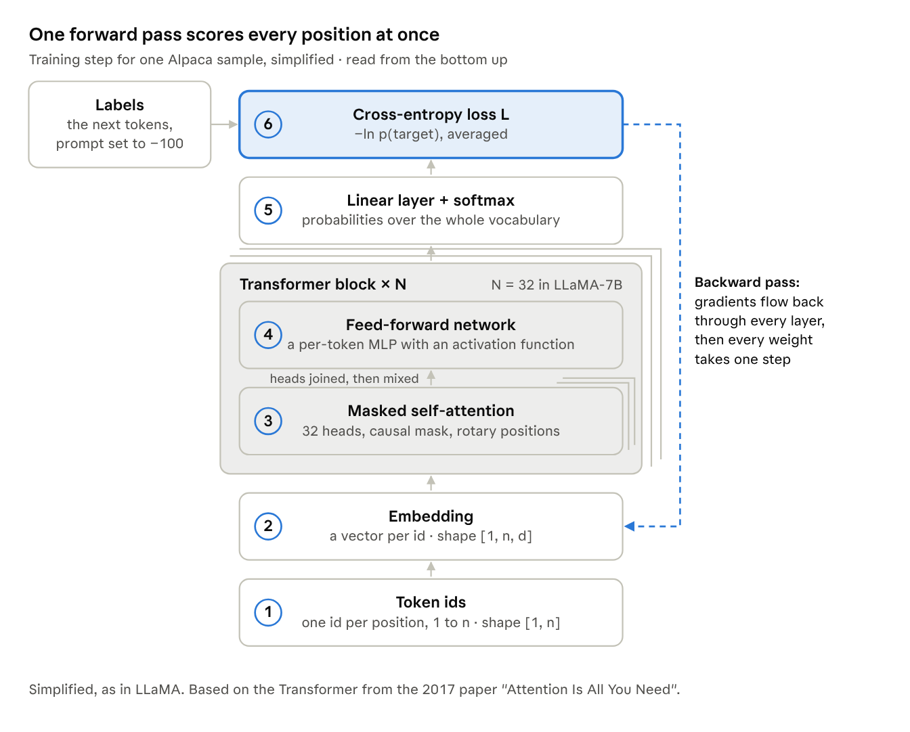

**All positions at once.** Within a layer, no position waits for another: the whole sequence is stacked into a matrix, one row per token, and a few matrix multiplications compute every position together. The only waiting is between layers, so the forward pass takes as many sequential steps as there are layers, however long the text is. Thanks to teacher forcing and the causal mask, every prediction in the sample is made and scored in that one pass. Generating text later is different: the model produces one token at a time and feeds each one back in.

**Tensor shapes along the way.** So far we have mostly followed one position at a time, as vectors and matrices. In practice the model works on all n positions of a sample at once (and usually on several samples at once), so its numbers are held in blocks with more dimensions. Machine learning libraries such as PyTorch and TensorFlow call any such block a **tensor**, and you will meet the word, and shapes written with commas, as soon as you read model code or papers. A tensor is just a block of numbers with any number of dimensions: a list of numbers (a vector), a grid (a matrix), a stack of grids, and so on. Its shape lists how many entries it has along each dimension. For example, \[1, n, 4096\] means 1 sample, n positions, and 4,096 numbers for each position. The picture below keeps it simple and follows just one position of one sample through a forward pass of LLaMA-7B: its main vector and the helper vectors made from it, each a single \[1 × d\] vector, with the bar showing its length d from ① to ⑤:

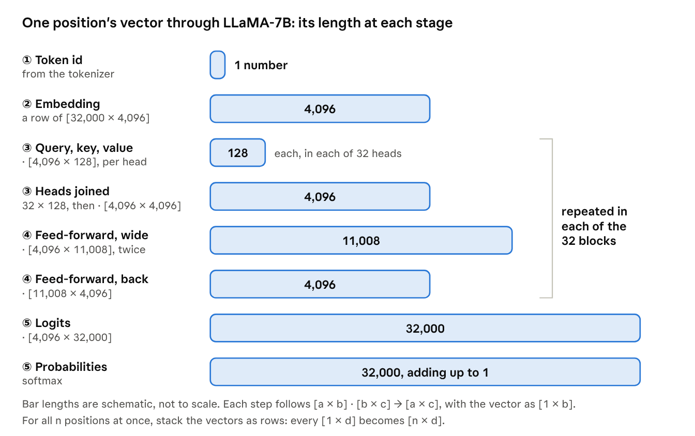

Now put the positions back together. Stacking the n positions of one sample as rows, and then the b samples of a batch on top of each other, gives the tensor shapes you would see printed in code:

| Stage | One position | One sample (n positions) | A batch of b samples |
| --- | --- | --- | --- |
| ① Token ids | 1 number | \[n\] | \[b, n\] |
| ② Embedding, the main vector | \[1 × 4,096\] | \[n, 4,096\] | \[b, n, 4,096\] |
| ③ Query, key or value, one head | \[1 × 128\] | \[n, 128\] | \[b, n, 128\] |
| ③ Attention weights, one head | \[1 × n\] | \[n, n\] | \[b, n, n\] |
| ④ Feed-forward, wide | \[1 × 11,008\] | \[n, 11,008\] | \[b, n, 11,008\] |
| ⑤ Logits, then probabilities | \[1 × 32,000\] | \[n, 32,000\] | \[b, n, 32,000\] |

The \[1, n, 4096\] example above is the main vector's tensor for a batch of one sample. The attention weights are the only row where n appears twice: every position has one weight for every position, the same grid as the causal mask in Step 3. At the very end, all these numbers collapse into the loss L, a single number.

**Step 5: The loss for each token.** From ⑤, every position ends with a probability for every token in the vocabulary: 32,000 probabilities that add up to 1. For the loss we look at only one of them: the probability the model gave to the **target**, the token that really comes next (Step 2). We write it **p(target)**. For example, at the position reading ▁is the target is ▁Paris. In the toy example of ⑤ the model spread its probability as ▁Paris 0.694, ▁Lyon 0.155, ▁London 0.094 and ▁the 0.057. Only ▁Paris is the target, so p(target) = 0.694, and the other three values are not used directly. The loss at that position is called the **cross-entropy**: the negative natural logarithm ln of p(target).

$$
\text{loss} = -\ln p(\text{target})
$$

**Why −ln?** Start from what we want the loss to do as p(target) moves between 0 and 1:

- When the model is certain and right, p(target) = 1, the loss should be 0.
- As p(target) falls, the loss should grow.
- As p(target) gets close to 0, the loss should grow very fast, so a model that is confidently wrong is pushed hardest.

The natural logarithm already has this shape, only upside down. ln 1 = 0, and as p falls towards 0, ln p drops faster and faster towards minus infinity, so it is negative everywhere below 1. Putting a minus sign in front flips the curve: the loss starts at 0 for p = 1 and climbs steeply as p falls. The graph shows both curves:

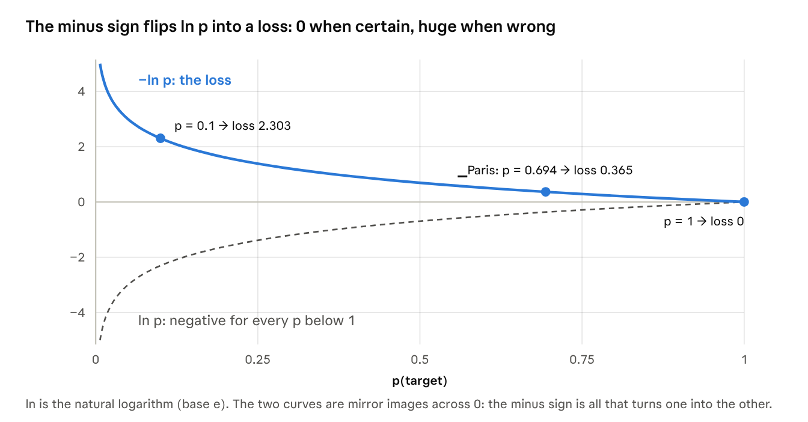

| p(target) | loss = −ln p |
| --- | --- |
| 1.0 (certain and right) | 0 |
| 0.9 | 0.105 |
| 0.694 (our ▁Paris) | 0.365 |
| 0.5 | 0.693 |
| 0.1 | 2.303 |
| 0.01 | 4.605 |

Going from 0.9 to 0.5 adds less than 0.6 to the loss, while going from 0.1 to 0.01 adds 2.3. The loss plays the same role as (y − ŷ)² in section 1: one number that is small when the prediction is good. The other 31,999 probabilities don't appear in the formula, but they still count. All the probabilities share a total of 1, so the only way to raise p(target) is to take probability away from the wrong tokens.

For our 8 scored response tokens, with illustrative probabilities:

| Target token | p(target) | −ln p |
| --- | --- | --- |
| The | 0.60 | 0.511 |
| capital | 0.70 | 0.357 |
| of | 0.95 | 0.051 |
| France | 0.90 | 0.105 |
| is | 0.85 | 0.163 |
| Paris | 0.694 | 0.365 |
| . | 0.90 | 0.105 |
| \</s> (end of text) | 0.75 | 0.288 |

$$
L = \frac{0.511 + 0.357 + \dots + 0.288}{8} = \frac{1.945}{8} \approx 0.243
$$

This single number L plays the same role as the loss L in the earlier examples: it is the one number that gradient descent makes smaller. Each token's −ln p(target) plays the part of one squared residual (y − ŷ)², and L combines them. The difference is how: RSS added the squared residuals up, while here we take the average, which is the same sum divided by the number of scored tokens, 8. Dividing by a fixed number makes every gradient 8 times smaller but leaves its direction unchanged.

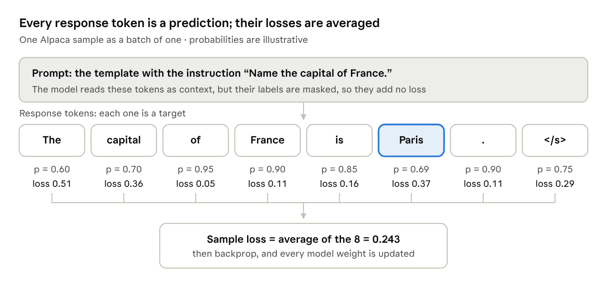

**Step 6: Start the backward pass at the softmax.** For softmax followed by cross-entropy, the gradient of one position's loss with respect to each logit has a famously simple form:

$$
\frac{\partial \thinspace  \text{loss}}{\partial \thinspace  \text{logit}_k} = p_k - \begin{cases} 1 & \text{if } k \text{ is the target} \cr  0 & \text{otherwise} \end{cases}
$$

This is the counterpart of ∂L/∂ŷ in the two-layer example. Take the position whose target is "Paris", with a toy four-word vocabulary:

| Candidate | Logit | p (softmax) | ∂loss/∂logit |
| --- | --- | --- | --- |
| Paris (target) | 3.0 | 0.694 | −0.306 |
| Lyon | 1.5 | 0.155 | +0.155 |
| London | 1.0 | 0.094 | +0.094 |
| the | 0.5 | 0.057 | +0.057 |

Read it as: push the target's score up, and push every wrong token's score down in proportion to the probability it took. Because L is an average over 8 tokens, each of these is also divided by 8 (for example, −0.306 / 8 ≈ −0.038).

**Step 7: Run backprop and add up.** From here, backprop runs exactly as in sections 3 and 4. The chain rule carries these signals back through every layer of the transformer, multiplying by local derivatives (activation slopes included) and using the values stored during the forward pass. What's new compared with the earlier examples is that one sample gives n scored predictions, in our case 8, and all 8 were made with the same weights: there is one set of query, key, value and other matrices, used at every position. So a single weight affects all 8 losses, and its gradient has to collect its effect on each of them. Since L is the average of the 8 losses, the weight's gradient is the average of its 8 separate gradients:

$$
\frac{\partial L}{\partial w} = \frac{1}{8} \left( \frac{\partial \thinspace  \text{loss}_1}{\partial w} + \frac{\partial \thinspace  \text{loss}_2}{\partial w} + \dots + \frac{\partial \thinspace  \text{loss}_8}{\partial w} \right)
$$

**Step 8: One update.** Finally, every weight in the model (often billions of them) takes one step:

$$
w \leftarrow w - \eta \thinspace  \frac{\partial L}{\partial w}
$$

In practice, fine-tuning uses an optimizer like Adam \[11\] and a very small learning rate (on the order of 0.00002). The model already knows a lot, and we only want to nudge it.

**How it maps onto the earlier examples**

| Earlier examples | One Alpaca sample |
| --- | --- |
| One input x | The token sequence (prompt plus response) |
| One prediction | A probability for every vocabulary token, at every position |
| Target y | The next token at each position (response positions only) |
| (y − ŷ)² | −ln p(target), averaged over the scored tokens |
| ∂L/∂ŷ = −2(y − ŷ) | ∂loss/∂logit = p − (1 for the target, else 0) |
| A few weights, a small gradient vector per layer | Millions to billions of weights, each shared across positions |
| One update per example | One update per batch |

**What "batch size" means.** With this sample as the whole batch, one sample gives one update: the purest form of stochastic gradient descent, fast but noisy. With a batch of, say, 64 samples, the losses of all scored tokens across all 64 samples are averaged into one L. Then there is one backward pass and one update for the whole batch. The gradient is a smoother estimate, so each step is more reliable.

## 6. Putting it together

### The training loop

Training a neural network repeats these four steps thousands or millions of times:

1. **Forward pass:** run a batch of examples through the network to get predictions.
2. **Compute the loss:** measure how wrong the predictions are.
3. **Backward pass (backprop):** compute the gradient of the loss for every weight.
4. **Update (gradient descent):** nudge every weight a small step against its gradient.

In short: *backprop tells you which way is downhill; gradient descent takes the step.*

### Common variants

- **Batch gradient descent:** uses the whole dataset for each step. Accurate but slow on big data.
- **Stochastic gradient descent (SGD):** uses one example per step. Fast and noisy; the noise can actually help escape poor spots.
- **Mini-batch gradient descent:** uses a small group (for example 32 or 256 examples) per step. The standard compromise in practice.
- **Momentum:** keeps a running average of past steps, like a ball rolling downhill that builds speed and smooths out zig-zags.
- **Adam:** adapts the step size for each weight automatically. A popular default choice.

### Common pitfalls

- **Poor learning rate:** the most frequent cause of training that stalls or blows up.
- **Local minima and saddle points:** the landscape has dips and flat regions that aren't the true bottom. In large networks this tends to matter less than people expect, and noise from mini-batches helps.
- **Vanishing gradients:** in deep networks, error signals can shrink as they pass backward through many layers, so early layers barely learn. Activation functions like ReLU and techniques like residual connections and normalization help.
- **Exploding gradients:** the opposite problem, where signals grow huge. Gradient clipping (capping the size of each step) is a common fix.

### Summary

- The **loss** measures how wrong the model is; training aims to minimize it.
- The **gradient** says how the loss changes as each weight changes.
- **Gradient descent** repeatedly moves weights a small step against the gradient, with step size set by the **learning rate**.
- **Backprop** uses the chain rule to compute all those gradients efficiently, by running a forward pass and then passing error signals backward through the network.
- Together they form the engine that trains virtually every modern neural network.

## Appendix A: Rotary position embeddings in detail

This appendix shows how RoPE, introduced in "Where position comes in" in section 5, rotates queries and keys. It happens inside every head, so for one head we follow the 128 numbers of a query and the 128 numbers of a key. As in Step 3, where we worked out z\_ij, i is the position we are calculating z for and supplies the query q\_i, and j is the position of the token it is compared against and supplies the key k\_j.

**Pairs of numbers.** RoPE cuts each 128-number vector into 64 pairs of neighbors, numbered p = 1 to 64. Pair 1 is numbers 1 and 2, pair 2 is numbers 3 and 4, and so on up to pair 64, numbers 127 and 128. The query and the key are each cut into their own 64 pairs. A pair \[x, y\] can be drawn as an arrow on a flat page: x steps to the right, y steps up. So a query is 64 small arrows, and so is a key.

**Turning one pair.** To turn the arrow \[x, y\] by an angle α, RoPE replaces it with \[x′, y′\]:

$$
\begin{aligned}
x' &= x \cos\alpha - y \sin\alpha \cr 
y' &= x \sin\alpha + y \cos\alpha
\end{aligned}
$$

Here sin α is the cosine's partner: for an arrow of length 1 at angle α, cos α is its shadow along the horizontal and sin α its shadow along the vertical. The arrow turns but keeps its length. For example, \[1, 0\] turned by 90° (cos 90° = 0, sin 90° = 1) becomes \[1 × 0 − 0 × 1, 1 × 1 + 0 × 0\] = \[0, 1\]: it pointed right and now points up.

**How far each pair turns.** Each pair p has its own fixed step θ\_p, and at position i it is turned i steps:

$$
\alpha = i \cdot \theta_p, \qquad \theta_p = 10000^{-(p-1)/64}
$$

The step is in radians: a full turn is 2π ≈ 6.28 radians, so 1 radian ≈ 57.3°. Pair 1 has θ₁ = 1 radian ≈ 57.3° per position and spins fast, like a clock's second hand. Pair 32 has θ₃₂ ≈ 0.0116 radians ≈ 0.66° per position. Pair 64 has θ₆₄ ≈ 0.000115 radians ≈ 0.0066° per position and barely moves, like an hour hand. Queries and keys use the same 64 steps: pair p of the query at position i turns by i · θ\_p, and pair p of the key at position j turns by j · θ\_p. The picture shows a fast and a slow pair at the first four positions, with simplified angles:

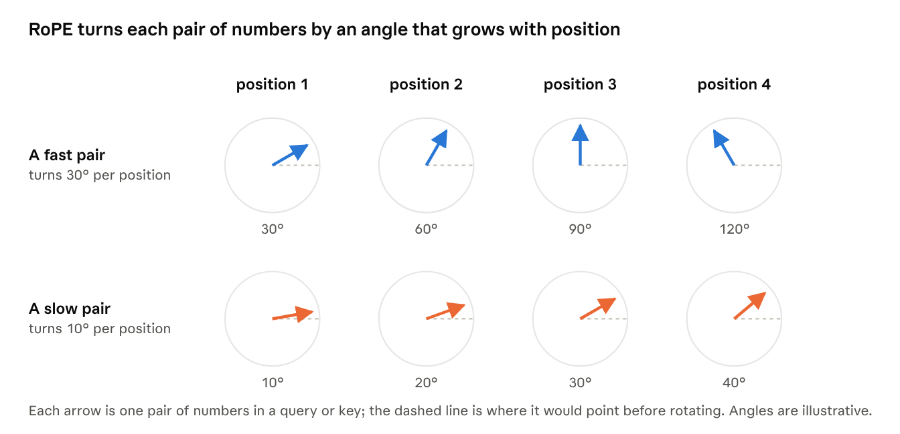

**Why the score ends up depending on distance.** The dot product q\_i · k\_j adds up 128 products, two from each pair, so it can be grouped into 64 pieces, one per pair:

$$
q_i \cdot k_j = (\text{pair 1 of } q_i) \cdot (\text{pair 1 of } k_j) + \dots + (\text{pair 64 of } q_i) \cdot (\text{pair 64 of } k_j)
$$

Each piece is the dot product of two small arrows. Rearranging the cosine similarity formula above, that equals their two lengths times the cosine of the angle between them:

$$
a \cdot b = \lVert a \rVert \thinspace  \lVert b \rVert \cos\theta
$$

Turning doesn't change the lengths, so only the angle between the two arrows can change. Before RoPE does anything, pair p of the query is just two numbers \[x, y\], and the arrow they draw points in some direction: call that the query's starting angle. Those two numbers come from multiplying the main vector by W\_Q, so the starting angle is whatever the main vector and W\_Q produce; RoPE hasn't touched it yet. Pair p of the key has its own starting angle in the same way, from W\_K. RoPE then turns the query's arrow by i · θ\_p and the key's by j · θ\_p, so:

$$
\begin{aligned}
\text{query arrow's angle} &= \text{query start} + i \cdot \theta_p \cr 
\text{key arrow's angle} &= \text{key start} + j \cdot \theta_p \cr 
\text{angle between them} &= (\text{query start} - \text{key start}) + (i - j) \cdot \theta_p
\end{aligned}
$$

The angle between them has two parts. The first, query start − key start, comes from the query and key as they were before turning. The second, (i − j) · θ\_p, is the only part RoPE adds, and it depends only on how far apart the two tokens are. The positions i and j never appear on their own, only their difference. Moving both tokens 100 positions later turns both arrows by an extra 100 · θ\_p, like moving both hands of a clock forward by the same amount, so the angle between them stays the same. For pair 1, a query at position 5 and a key at position 3 are turned by 5 and 3 radians, a difference of 2; at positions 105 and 103 the difference is again 2. That lets the model learn patterns like "the token just before me" that work anywhere in a sequence.

**Near and far.** Because every pair turns at its own speed, the same distance i − j shows up as a different extra angle (i − j) · θ\_p in each pair. Here it is for three of the 64 pairs at four distances, with full turns of 360° removed, since an arrow turned by a full turn points the same way again:

| Pair | Distance 1 | Distance 10 | Distance 100 | Distance 1,000 |
| --- | --- | --- | --- | --- |
| Pair 1 (57.3° per position) | 57° | 213° | 330° | 56° |
| Pair 32 (0.66° per position) | 0.66° | 6.6° | 66° | 302° |
| Pair 64 (0.0066° per position) | 0.0066° | 0.066° | 0.66° | 6.6° |

Pair 1 turns a lot even between neighbors, so it clearly tells distance 1 from distance 2. Over longer distances it goes around many times, so it can't tell them apart: distance 1,000 lands at 56°, right next to distance 1's 57°. Pair 64 hardly moves between neighbors, but its angle keeps growing steadily over thousands of tokens. The pairs in between cover the middle ranges. Like the second, minute and hour hands of a clock, the 64 pairs read together pin down the distance, near or far. Through W\_Q and W\_K, training learns which pairs to put information in: fast pairs for patterns about nearby tokens, slow pairs for patterns about distant ones. Only queries and keys are turned; values are left as they are.

## References

1. Minsky, M. and Papert, S. (1969). *Perceptrons: An Introduction to Computational Geometry*. MIT Press.
2. Rumelhart, D. E., Hinton, G. E. and Williams, R. J. (1986). Learning representations by back-propagating errors. *Nature*, 323, 533–536.
3. Vaswani, A., Shazeer, N., Parmar, N., Uszkoreit, J., Jones, L., Gomez, A. N., Kaiser, Ł. and Polosukhin, I. (2017). Attention Is All You Need. *Advances in Neural Information Processing Systems 30 (NeurIPS 2017)*. [arXiv:1706.03762](https://arxiv.org/abs/1706.03762)
4. Touvron, H. et al. (2023). LLaMA: Open and Efficient Foundation Language Models. [arXiv:2302.13971](https://arxiv.org/abs/2302.13971)
5. Taori, R. et al. (2023). Stanford Alpaca: An Instruction-following LLaMA Model. [github.com/tatsu-lab/stanford\_alpaca](https://github.com/tatsu-lab/stanford_alpaca)
6. Sennrich, R., Haddow, B. and Birch, A. (2016). Neural Machine Translation of Rare Words with Subword Units. *ACL 2016*. [arXiv:1508.07909](https://arxiv.org/abs/1508.07909)
7. Radford, A., Wu, J., Child, R., Luan, D., Amodei, D. and Sutskever, I. (2019). Language Models are Unsupervised Multitask Learners. OpenAI technical report (GPT-2).
8. Devlin, J., Chang, M.-W., Lee, K. and Toutanova, K. (2019). BERT: Pre-training of Deep Bidirectional Transformers for Language Understanding. *NAACL 2019*. [arXiv:1810.04805](https://arxiv.org/abs/1810.04805)
9. Kudo, T. (2018). Subword Regularization: Improving Neural Network Translation Models with Multiple Subword Candidates. *ACL 2018*. [arXiv:1804.10959](https://arxiv.org/abs/1804.10959)
10. Kudo, T. and Richardson, J. (2018). SentencePiece: A simple and language independent subword tokenizer and detokenizer for Neural Text Processing. *EMNLP 2018 (system demonstrations)*. [arXiv:1808.06226](https://arxiv.org/abs/1808.06226)
11. Kingma, D. P. and Ba, J. (2015). Adam: A Method for Stochastic Optimization. *ICLR 2015*. [arXiv:1412.6980](https://arxiv.org/abs/1412.6980)
12. Kelleher, J. D. (2019). *Deep Learning*. MIT Press Essential Knowledge series. MIT Press.
13. Su, J., Lu, Y., Pan, S., Murtadha, A., Wen, B. and Liu, Y. (2021). RoFormer: Enhanced Transformer with Rotary Position Embedding. [arXiv:2104.09864](https://arxiv.org/abs/2104.09864)
14. Shazeer, N. (2020). GLU Variants Improve Transformer. [arXiv:2002.05202](https://arxiv.org/abs/2002.05202)

---

© 2026 FOAM Foundation and contributors. Licensed under
[CC BY-NC-SA 4.0](../../LICENSE-CONTENT); code snippets also under the
[Apache License 2.0](../../LICENSE-CODE).
