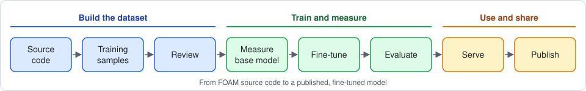
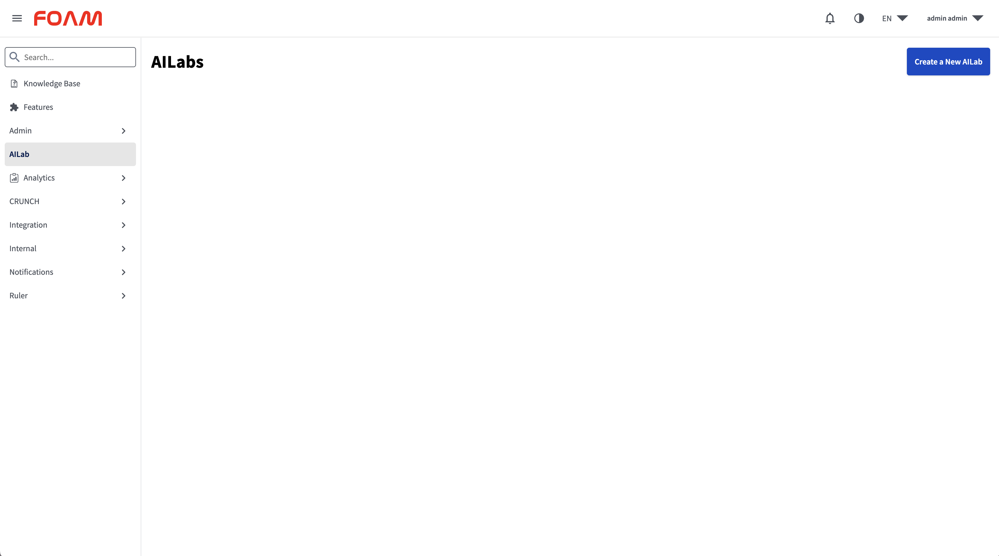
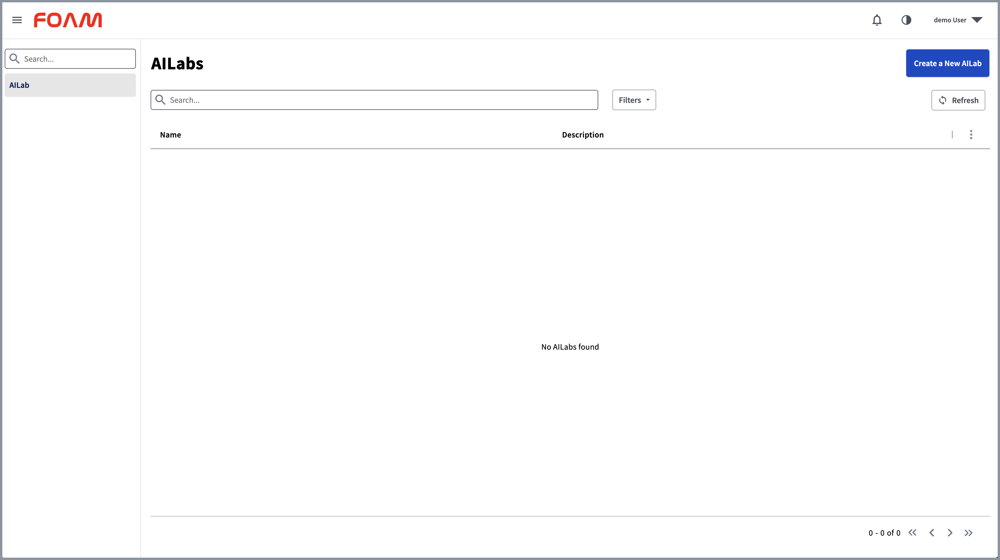
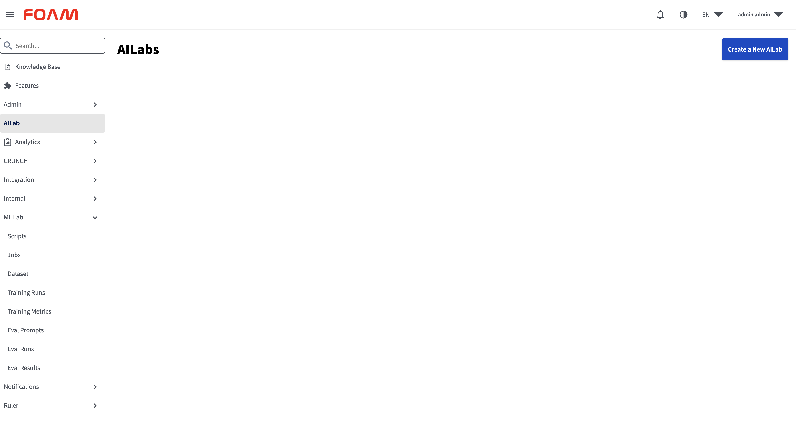
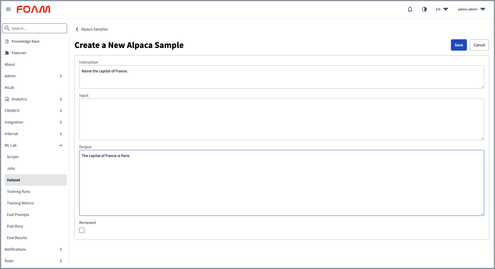
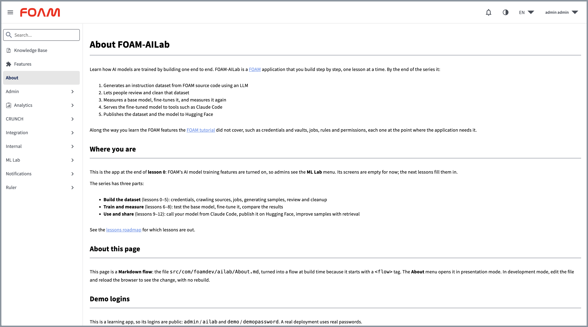
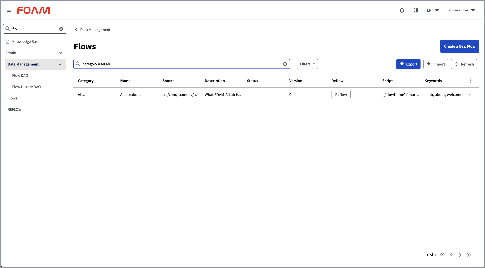

# Lesson 0: Setup and the plan

In this lesson you get FOAM-AILab running, turn on FOAM's AI model training
features, and give the app a welcome page. Along the way you see where the
series is going and what each new screen will be used for.

**What you'll learn:**

- How FOAM build flags turn optional features on, and why the app's POM is the right place to set them
- How flags decide which journal files go into the build
- How a Markdown file becomes a page in the app (a Markdown flow)

**Before you start:** complete the [FOAM tutorial](https://github.com/foam-foundation/foam3/blob/development/doc/tutorials/foam-tutorial.md) and check
the hardware notes in the [lessons overview](README.md#hardware).

**Starting point:** the `start` tag. **End state:** the `lesson-00` tag.

## 1. Where we're going

By the end of the series, FOAM-AILab runs a complete training pipeline:



The heart of it is the **training sample**. We use the Alpaca format: an
instruction, an optional input, and the output the model should learn to give.
This is the sample the foundations guide follows through one training step
([§5 *The sample*](../foundations/Neural-Network-Training-Demystified.md#the-sample)):

```json
{
  "instruction": "Name the capital of France.",
  "input": "",
  "output": "The capital of France is Paris."
}
```

Our samples are about FOAM code instead of capitals, but the shape is the same.
The foundations guide then shows what happens to a sample before training:

- [Step 1: Format and tokenize](../foundations/Neural-Network-Training-Demystified.md#step-1-format-and-tokenize): the three fields become one piece of text, which is split into tokens. [How text becomes numbers](../foundations/Neural-Network-Training-Demystified.md#tokenizers-how-text-becomes-numbers) explains tokenizers.
- [Step 2: Inputs and targets](../foundations/Neural-Network-Training-Demystified.md#step-2-inputs-and-targets-teacher-forcing): each token is paired with the token the model must predict next.

A few decisions hold for the whole series:

- **Training runs on** [MLX](https://github.com/ml-explore/mlx) on Apple Silicon Macs, with a small model (Qwen2.5-Coder-1.5B by default; see [Hardware](README.md#hardware)).
- **Samples are written by an LLM**: [Ollama](https://ollama.com) for free on your own machine, or a paid API for better samples. Every lesson works with Ollama.
- **The training data comes from public FOAM source code**, so you can share your dataset and model when you're done.

## 2. Fork, clone, build

Fork this repository on GitHub, then clone your fork with its `foam3`
submodule and check out the starting point:

```bash
git clone --recurse-submodules git@github.com:<your-account>/FOAM-AILab.git
cd FOAM-AILab
git checkout start
git submodule update
```

> [!IMPORTANT]
> Don't leave out `--recurse-submodules`. FOAM itself lives in the `foam3`
> folder, a git submodule, and a plain `git clone` leaves that folder empty: the
> build then fails. If that happened, run `git submodule update --init`.
>
> `git submodule update` after `git checkout start` matters too: it moves
> `foam3` to the FOAM version that `start` uses. Run it every time you check out
> a lesson tag.

This uses SSH, like the FOAM tutorial's [Initial Setup](https://github.com/foam-foundation/foam3/blob/development/doc/tutorials/foam-tutorial.md#initial-setup). If
you haven't set up SSH keys with GitHub yet, see the
[GitHub SSH guide](https://docs.github.com/en/authentication/connecting-to-github-with-ssh/generating-a-new-ssh-key-and-adding-it-to-the-ssh-agent).

Build and start the app with the demo deployment:

```bash
./build.sh -Jdemo -jc
```

What each option does:

- `-Jdemo` adds the journals in `deployment/demo`, such as the demo user.
- `-j` deletes the **runtime journals**: everything entered while the app ran, such as data and uploaded documents. You start from clean data.
- `-c` cleans the generated code before building, so nothing stale is left from an earlier build.

Because `-j` deletes data, the build asks first. Answer `y` to delete, `n` to
keep the journals, or `b` to back them up and then delete. In lesson 0 there's
nothing to keep, so `y` is fine. From lesson 4 on, your dataset lives in the
runtime journals: leave out `-j`, or answer `b`.

> [!WARNING]
> You may see `-y` in other FOAM projects. It answers the question for you,
> with "yes" and no backup. Avoid it once your data matters.

More build tips are collected on the [Tips](tips.md) page.

Open [http://localhost:8080](http://localhost:8080) and log in as **admin**. This is a learning app,
so its logins are public: `admin` / `ailab` and `demo` / `demopassword`. A real
deployment uses real passwords.

> [!IMPORTANT]
> Don't see a change you just made? Do a **hard reload**: <kbd>Cmd</kbd>+<kbd>Shift</kbd>+<kbd>R</kbd>
> on a Mac, <kbd>Ctrl</kbd>+<kbd>Shift</kbd>+<kbd>R</kbd> on Windows and Linux. The browser keeps
> copies of the app's files, and a normal reload may still show the old ones.
> Make it a habit after every build.

You see the app as the FOAM generator created it: an **AILab** menu with a
default model, and FOAM's standard admin menus. There's no sign of
anything to do with training models.

> 🐒 **Curious?** An app like this one is made by FOAM's project generator.
> See [Generate Application](https://github.com/foam-foundation/foam3/blob/development/doc/tutorials/foam-tutorial.md#generate-application) in the FOAM tutorial.



The **demo** user sees even less: only the AILab menu.



## 3. The problem: where is the AI code?

FOAM already has models for datasets, training runs and evaluations, in
`foam3/src/foam/core/ai/dataset` and `foam3/src/foam/core/ai/training`. So
why doesn't the app show them?

Because they are **optional**. Most FOAM apps don't train models, so these
packages are only built when an app asks for them. Look at
`foam3/src/foam/core/ai/pom.js`:

```js
projects: [
  { name: '../../ai/llm/pom' },
  { name: 'llm/pom' },
  { name: 'vector/pom' },
  // ML training (datasets, training and eval runs) is opt-in: an app that
  // wants it sets the ml flag, e.g. setFlags: { ml: true } in its POM.
  { name: 'dataset/pom',  flags: 'ml' },
  { name: 'training/pom', flags: 'ml' }
],
```

The `flags: 'ml'` on the last two entries means: include this sub-POM only
when the `ml` flag is on. It is off by default. (LLMs and vector search,
the first three entries, are always included. The series uses them as they
are; see the [FOAM guides](https://github.com/foam-foundation/foam3/tree/development/doc/guides).)

## 4. The quick way: a command-line flag

You can turn a flag on for one build:

```bash
./build.sh -Jdemo -jc --flags:ml
```

Log in as admin, and an **ML Lab** menu appears. It works, but only for this
build: run `./build.sh -Jdemo -jc` again and ML Lab is gone. Every build, by
you or anyone else who clones the app, has to remember the flag.

## 5. The proper way: setFlags in the app's POM

This app needs ML Lab on every build, so the app should say so itself. Open
the root `pom.js` and add `setFlags` after `excludes`:

```js
  excludes: [ '*' ],
  setFlags: { ml: true }, // FOAM's AI model training features: ML Lab menus, dataset and training models
```

Build without any flag:

```bash
./build.sh -Jdemo -jc
```

The build log confirms it:

```
Setting flag: ml = true
```

`setFlags` even wins over the command line: `--flags:-ml` (turn `ml` off) has
no effect now. The order, highest first:

1. URL parameters (in the browser)
2. `setFlags` in a POM; the first POM to set a flag wins, so the app's POM beats foam3's
3. The command line (`--flags:`)
4. Defaults

See the [Flags guide](https://github.com/foam-foundation/foam3/blob/development/doc/guides/Flags.md) for the details.

## 6. Refresher: flags and journals

How did one flag add a whole menu? A flag on a `projects:` entry gates the
**whole sub-POM**: its models, and also its journal (`.jrl`) files. ML Lab's
menus are defined in `foam3/src/foam/core/ai/training/menus.jrl` and
`foam3/src/foam/core/ai/dataset/menus.jrl`. With `ml` off, the build never
reads them; with `ml` on, they become part of the app's `menus` journal.

As a reminder of how the build puts journals together:

- Every static `.jrl` file is merged into one `.0` journal per DAO (`menus.0`, `flows.0`, ...), in POM order.
- Deployment journals (`-Jdemo` → `deployment/demo`) are merged after, so they can add or replace entries; the last one wins.
- Runtime journals, the changes you make while the app runs, are replayed on top.

The tutorial's appendix [Journal Merging In-Depth](https://github.com/foam-foundation/foam3/blob/development/doc/tutorials/foam-tutorial.md#journal-merging-in-depth) has the
full story.

Log in as admin again. ML Lab now has eight screens:



Log in as demo: no ML Lab. Demo has no permission for it yet. Who may do what
with the dataset is the subject of lesson 5.

## 7. A tour of ML Lab

The screens are empty for now. Each one holds a part of the pipeline, and
most of them connect to an idea in the [foundations guide](../foundations/Neural-Network-Training-Demystified.md):

| Screen | What it holds | The theory behind it | Filled in |
|---|---|---|---|
| Dataset | Training samples: instruction, input, output, source file, status | [§5 *The sample*](../foundations/Neural-Network-Training-Demystified.md#the-sample): the same Alpaca record | Lesson 4, cleaned in 5 |
| Scripts / Jobs | The work: crawl, generate, train, evaluate | (FOAM, not theory) | Lesson 3 onward |
| Eval Prompts | Test questions, each with the patterns a good answer must contain | Measure before you change anything | Lesson 6 |
| Training Runs | One row per run: base model, dataset, final loss, best checkpoint | [§6 *The training loop*](../foundations/Neural-Network-Training-Demystified.md#the-training-loop) | Lesson 7 |
| Training Metrics | Training and validation loss at each step | [§2 Gradient descent](../foundations/Neural-Network-Training-Demystified.md#2-gradient-descent); [§5 Step 5](../foundations/Neural-Network-Training-Demystified.md#step-5-the-loss-for-each-token) (the loss for each token) | Lesson 7 |
| Eval Runs / Results | Pass rate per model, and each answer with the patterns it hit | Did the model actually learn? | Lessons 6 and 8 |

Validation loss, checkpoints and LoRA are explained in lesson 7.

### Try it: add the sample by hand

Open **ML Lab → Dataset** and click **Create a New Alpaca Sample**. Enter the
France sample:

- **Instruction:** `Name the capital of France.`
- **Input:** leave it empty
- **Output:** `The capital of France is Paris.`



Click **Save**. The new row has fields you didn't fill in:

- **Id**: `4ee4665f3cbe34f1`, the start of a SHA-256 hash of the instruction and the output. The same sample always gets the same id, which is how the pipeline spots exact duplicates.
- **Char count**: 58, the length of the three fields together.
- **Status**: **New**.

FOAM generates this create screen automatically from its `AlpacaSample` model.
Here is a snippet of that model, shortened to the properties that matter now:

```js
foam.CLASS({
  package: 'foam.core.ai.dataset',
  name: 'AlpacaSample',

  properties: [
    {
      class: 'String',
      name: 'id',
      createVisibility: 'HIDDEN',
      updateVisibility: 'RO',
      javaFactory: 'return hash_(getInstruction() + getOutput());'
    },
    { class: 'String', name: 'instruction', required: true },
    { class: 'String', name: 'input' },
    { class: 'String', name: 'output', required: true },
    { class: 'Int',    name: 'charCount', createVisibility: 'HIDDEN' },
    { class: 'Enum', of: 'foam.core.ai.dataset.AlpacaSampleStatus', name: 'status', value: 'NEW', createVisibility: 'HIDDEN' }
  ]
});
```

The three Alpaca fields are the only ones the create form shows; the others are
`HIDDEN` there. The `javaFactory` computes the id on the server when the sample
is saved. The full model is
[`foam3/src/foam/core/ai/dataset/AlpacaSample.js`](https://github.com/foam-foundation/foam3/blob/development/src/foam/core/ai/dataset/AlpacaSample.js); for how FOAM
models work, see [Understanding FOAM Models](https://github.com/foam-foundation/foam3/blob/development/doc/tutorials/foam-tutorial.md#understanding-foam-models) in the FOAM
tutorial.

Char count and status are set by a FOAM **rule** that runs when a sample is
created. You'll write rules of your own in lesson 5.

Now delete the sample. The row stays, with status **Discarded**: another rule
marks a sample Discarded instead of deleting it, because the dataset will soon
keep extra data for each sample that has to be cleaned up with it. You can
leave the row; lesson 5 covers what Discarded means.

> 🐒 **Curious?** The "extra data" is an *embedding*: a vector that captures
> what the instruction means, so the pipeline can reject a new sample that is
> too similar to an existing one. Making embeddings needs a running model,
> which we set up in lesson 4. If you already run [Ollama](https://ollama.com)
> with an embedding model, your sample shows **Created** instead of New, and
> the delete removes it.

## 8. A welcome page

The app still opens on the **AILab** screen, the generator's default. A new
user learns more from a page that says what the app is, so let's make that the
landing page instead. In FOAM, a page of text can be a **Markdown flow**: a
`.md` file that starts with a `<flow>` tag. The build turns it into a flow, and
a menu can show it.

Create `src/com/foamdev/ailab/About.md`. The first line is the tag; the rest is
ordinary Markdown:

```markdown
<flow name="AILab:about" label="About FOAM-AILab" category="AILab" spid="aILab" accessLevel="PUBLIC_RO" description="What FOAM-AILab is and where the lessons are going." keywords="ailab,about,welcome"/>

# About FOAM-AILab

Learn how AI models are trained by building one end to end. ...
```

Write your own text, or copy the page from the [`lesson-00` tag](https://github.com/foam-foundation/FOAM-AILab/blob/lesson-00/src/com/foamdev/ailab/About.md).
The tag's attributes:

- `name`: the flow's id. Our flows start with `AILab:`, the way foam3's use prefixes such as `MCP:`.
- `spid`: the service provider the flow belongs to. Demo can only read data of the `aILab` service provider; without this attribute, demo would see an empty page. See the [SPID guide](https://github.com/foam-foundation/foam3/blob/development/doc/guides/SPID.md) for how service providers work.
- `accessLevel="PUBLIC_RO"`: every user can read it, and nobody can change it.

The page lives next to the app's code, not in `journals/`: that folder holds
`.jrl` data, and the build finds `.md` files in any folder of the app's POM.

Next, the menu. In `journals/menus.jrl`, replace the generated `aILab.aILab`
entry (the one with `"label":"AILab"` and a `DAOMenu2` handler) with a menu
that opens the flow:

```js
p({
  "class":"foam.core.menu.Menu",
  "id":"aILab.about",
  "label":"About",
  "authenticate":true,
  "handler":{
    "class":"foam.core.menu.FlowMenu",
    "flow":"AILab:about"
  }
})
```

`FlowMenu` shows the flow as a page (in presentation mode, without REFLOW's
editing tools). It is one of several menu **handlers**, each opening a
different kind of screen; the FOAM tutorial's
[Menu Navigation](https://github.com/foam-foundation/foam3/blob/development/doc/tutorials/foam-tutorial.md#menu-navigation) section lists the others.

Make it the page the app opens on. In `journals/themes.jrl`, change
`defaultMenu`:

```js
"defaultMenu": ["aILab.about"],
```

And let demo see the new menu. In `journals/groupPermissionJunctions.jrl`,
replace the permission for the old menu, `menu.read.aILab.aILab`, with:

```js
p({class:"foam.core.auth.GroupPermissionJunction",sourceId:"aILab",targetId:"menu.read.aILab.about"})
```

Rebuild:

```bash
./build.sh -Jdemo -jc
```

Log in. The app opens on your page:



See what the build made of your file: as admin, open **Admin → Data
Management → Flow DAO** and search for `category = AILab`. There's your page,
`AILab:about`, stored as a flow like any other record, with **Source**
`src/com/foamdev/ailab/About.md`. (To find a menu fast, type part of its name,
such as `flo`, in the search box above the menu.)



> 🐒 **Curious?** The record comes from the journal file
> `/opt/aILab/journals/flows.0`. Search it for `AILab:about`: the build turned
> your `.md` file into a journal entry, the same way it merges every `.jrl`
> file you've written.

## 9. Checkpoint

- [ ] The build log shows `Setting flag: ml = true`.
- [ ] Admin lands on the About page and sees **ML Lab** with eight screens, and no **AILab** menu.
- [ ] Demo lands on the About page and sees only **About**.
- [ ] The Dataset has no samples, or only the France sample, Discarded.

Compare with the `lesson-00` tag: `git diff start lesson-00`.

## 10. Troubleshooting

See also the [Tips](tips.md) page.

- **No ML Lab** after adding `setFlags`. The build may be stale; build again with `-c`.
- **The build behaves strangely**, or still shows old classes after `-c`. Remove the whole build output and rebuild it without starting the server: `./build.sh -XcleanAll -o` (`-XcleanAll` removes `build/` and the app's `lib/`; `-o` builds only). Then build as usual.
- `foam: malformed flags`. A flag expression has spaces in it, such as `--flags:"ml, dev"`. Write it without spaces.
- **The build fails on missing foam3 files.** The submodule isn't checked out: run `git submodule update --init`.
- **No ML Lab, but the build log shows the flag.** You're logged in as demo; log in as admin.
- **Port 8080 is in use.** Another copy of the app (or something else) is running. Stop it and build again.
- **The About page is empty for demo.** Check the `<flow>` tag has `spid="aILab"`, then rebuild.

## Next

[Lesson 1: Credentials and the vault](README.md#roadmap): store your Hugging
Face token safely.
